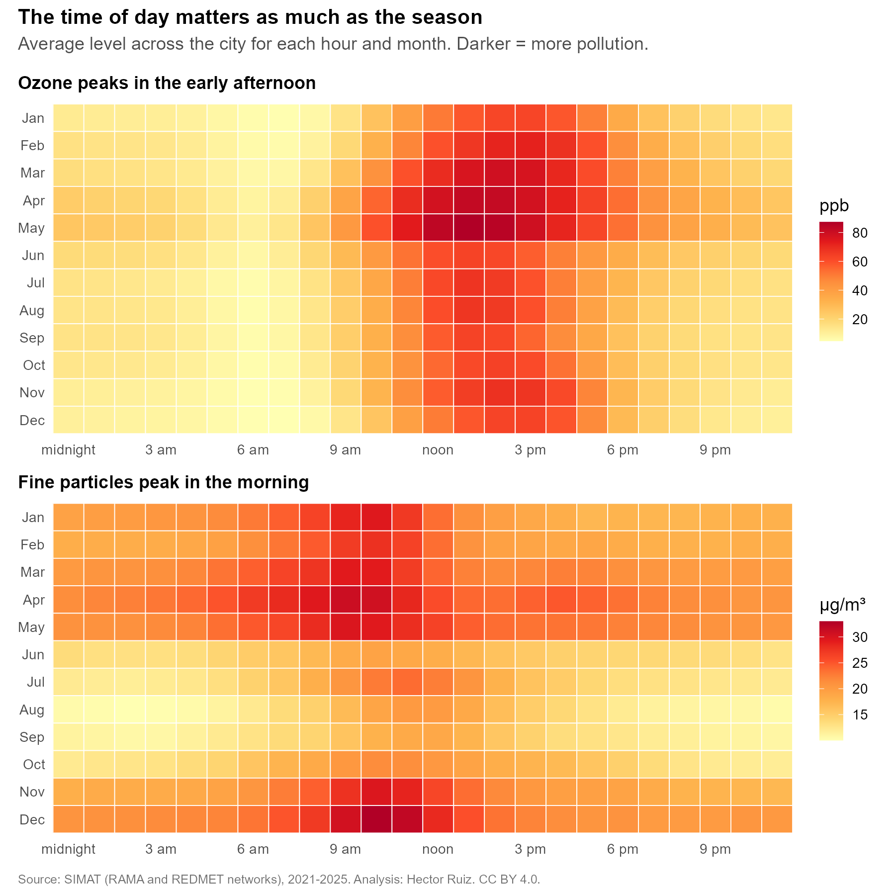
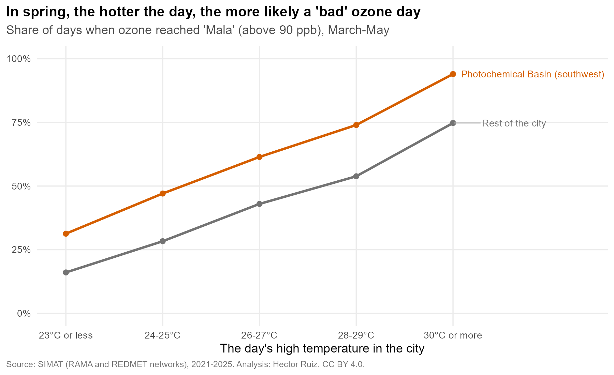
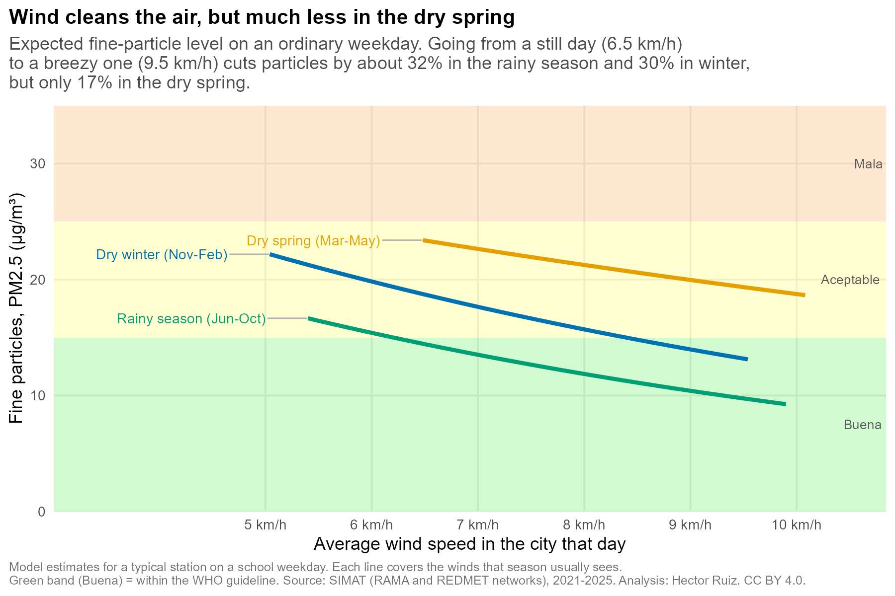
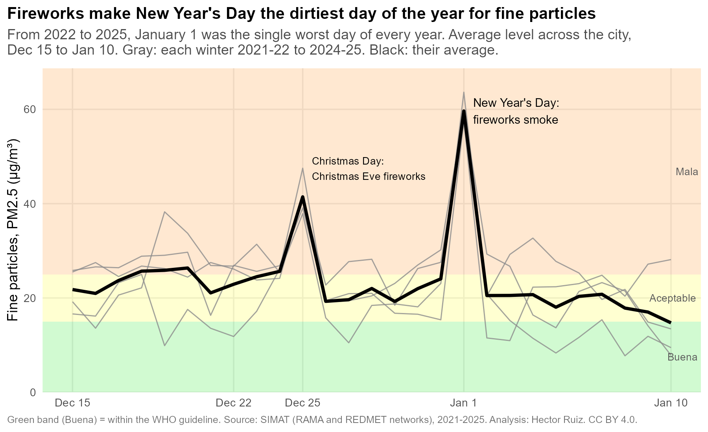
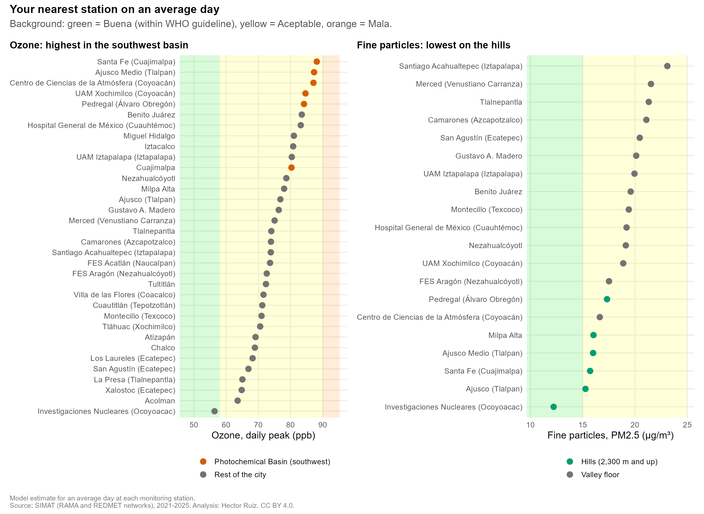

*By [Hector Ruiz](https://www.linkedin.com/in/hector-ruiz-g/)*

In 2023, my three-year-old caught a respiratory bug that turned into pneumonia, and we spent a week in the hospital. I still remember the neurotic beeping of the monitors, which met a loose sensor and a real emergency with the same panic. Every day my wife and I had to tell him he couldn't go home yet. We coaxed his hands away from the needles and put the oxygen mask back on his face, again and again. It is a particular kind of helplessness: watching someone you love labor to breathe, when the most you can do is share the hours, repeat the bedside rituals, and hope it is enough.

Anyone who has lived here a while learns to read the air. You can tell from the horizon: the mornings when the nata sits thick and the far side of the city simply isn't there, and the rare clear ones, usually after a hard rain, that feel like a gift. You can tell from your body: eyes that sting by midafternoon, a throat that stays scratchy all through the dry months, the dull headache that comes with the worst afternoons.

And most of us know some version of that helplessness, even without a hospital. It is the cough and wheeze that won't leave your kid, and your mother reaching for her inhaler. It is recess held indoors because the air outside is unsafe, and the run in the park you are told to skip. And it is sending them out the door anyway, because there is school, and work, and a clinic appointment on the other side of the city, and life does not wait for the air to clear.

That helplessness is not imagined. The decisions that would change our air the most are out of our hands: what gets burned at the refinery and power plant in Tula, whether the old trucks that belch black smoke stay on the road, how the city is built and how long it takes to cross it. Those decisions belong to governments and companies, and they deserve our pressure. Most of us cannot simply move, switch schools, or change jobs either. We live where we live, and many of us work where we must: street vendors, delivery riders, and traffic police are out on the worst days too, because stopping is not an option.

Still, having little control is not the same as having none. Inside the lives we already have, there is a margin, narrow but real, and I wanted to know how wide it is. When is the air at its worst, and when is it better? Where does it matter, and where doesn't it? Which small choices are worth the trouble, and which are not?

So I went through five years (2021 to 2025) of hourly readings from the city's own monitoring stations, together with its weather records and the school calendar. I'm a curious chilango, not an epidemiologist or atmospheric scientist. My numbers can show when and where the air tends to be worse. They can't predict what will happen to any one person, and on their own they can't show what the air does to our health; for that, I rely on the studies I link to. I'll try not to frighten you more than the evidence warrants, or reassure you more than it allows. When the evidence is solid I'll say so, and when it is thin I'll say that too. Every outside claim links to its source, and the [technical appendix](methodology.qmd) explains how I got my own numbers and where they could be wrong.

The short version is this: what day it is matters more than which neighborhood you live in; most of the long-term harm comes from ordinary days rather than rare terrible ones; and the margin I mentioned is real enough to be worth using.

## What *Aceptable* really means

If you check the air on a weather app or on the city's [air quality website](http://www.aire.cdmx.gob.mx "Sistema de Monitoreo Atmosférico de la Ciudad de México (SIMAT)."), you have seen the official colors: green for *Buena*, yellow for *Aceptable*, orange for *Mala*. They come from a federal standard, [NOM-172](https://sinaica.inecc.gob.mx/archivo/noms/NOM-172-SEMARNAT-2023-Indice-AIRE-y-SALUD.pdf "NOM-172-SEMARNAT-2023. Lineamientos para la obtención y comunicación del índice de calidad del aire y riesgos a la salud. Diario Oficial de la Federación."), and there is something the colors don't tell you. The edge of green sits exactly where the [World Health Organization](https://iris.who.int/server/api/core/bitstreams/551b515e-2a32-4e1a-a58c-cdaecd395b19/content "World Health Organization (2021). WHO global air quality guidelines: particulate matter (PM2.5 and PM10), ozone, nitrogen dioxide, sulfur dioxide and carbon monoxide. Geneva: WHO.") draws its line for health. Yellow, despite its reassuring name, runs up to the legal limits Mexico has set as achievable for now, for [fine particles](http://www.aire.cdmx.gob.mx/descargas/monitoreo/normatividad/NOM-025-SSA1-2021.pdf "NOM-025-SSA1-2021. Salud ambiental. Criterio para evaluar la calidad del aire ambiente, con respecto a las partículas suspendidas PM10 y PM2.5. Diario Oficial de la Federación.") and for [ozone](http://www.aire.cdmx.gob.mx/descargas/monitoreo/normatividad/NOM-020-SSA1-2021.pdf "NOM-020-SSA1-2021. Salud ambiental. Criterio para evaluar la calidad del aire ambiente, con respecto al ozono (O3). Diario Oficial de la Federación."). It is a compromise, not a safe zone.

By the WHO's measure, fine particles and ozone were each above its daily guideline on about two out of every three days between 2021 and 2025. The guideline itself allows three or four such days a year. (Since January 2026 the legal limit for fine particles is stricter, so you may notice more orange days than before. The air didn't get worse; the bar got higher.)

What does that cost us? The best long-term evidence comes from [a natural experiment in China](https://pmc.ncbi.nlm.nih.gov/articles/PMC5625887/pdf/pnas.201616784.pdf "Ebenstein, A., Fan, M., Greenstone, M., He, G., & Zhou, M. (2017). New evidence on the impact of sustained exposure to air pollution on life expectancy from China's Huai River Policy. PNAS."), where a decades-old heating policy left people on one side of a river breathing much dirtier air than people on the other. Researchers at the University of Chicago turned that finding into a rule of thumb, the [Air Quality Life Index](https://aqli.epic.uchicago.edu/files/Report%20-%20English%20Global%20View.pdf "Energy Policy Institute at the University of Chicago (2025). Air Quality Life Index: Annual Update."): every additional 10 micrograms of fine particles per cubic meter, breathed over a lifetime, costs roughly one year of life expectancy. Applied to Mexico City's average, that comes to about a year and a half, compared with air that meets the WHO guideline. Given the uncertainty, it could be as little as half a year or as much as two and a half; the Index's own estimate for the city is [1.6 years]{.hover-note title="Either way, it is an average across millions of people, not a prediction about you or your child."}.

Two things follow, and they pull in opposite directions. Yellow days are not harmless: ordinary *Aceptable* days account for almost half of that long-term toll, simply because there are so many of them. And yet no single bad day is a catastrophe for any one person. What weighs most is the everyday level of the air we breathe, which also happens to be where small, repeated choices add up.

For ozone, a yellow day means something more immediate. Ozone is an irritant that matters hour by hour (stinging eyes, a tight chest, harder days for anyone with asthma), especially for children, older adults, and people with heart or lung conditions. Its long-term toll is [less well established](https://iris.who.int/server/api/core/bitstreams/551b515e-2a32-4e1a-a58c-cdaecd395b19/content "World Health Organization (2021). WHO global air quality guidelines: particulate matter (PM2.5 and PM10), ozone, nitrogen dioxide, sulfur dioxide and carbon monoxide. Geneva: WHO."), so I won't put a number on it.

## Two pollutants, two clocks

The two pollutants that matter most here behave very differently. Fine particles are the soot, dust, and smoke the city puts into the air, from exhaust pipes, street grills, and construction, plus particles that form later out of gases. Ozone, on the other hand, comes out of no chimney at all: it is cooked in the air itself, when sunlight acts on the fumes from traffic and industry. Because they are made differently, they keep different hours.

The chart below shows the city's average for every hour of every month over five years. Each row is a month and each column an hour of the day; the darker the square, the dirtier the air.

{fig-alt="Two heat maps of hour of day by month. Ozone is low overnight and peaks between noon and 3 pm, strongest from March to May. Fine particles peak around 9 to 10 am, strongest from November to May, and ease through the afternoon and evening."}

Particles peak in mid-morning, around 9 or 10. Overnight, a lid of cold air settles over the valley, and the morning's traffic pours its exhaust into a shallow layer with nowhere to go; as the sun comes up, some of those gases also turn into new particles. By late morning the ground has warmed enough to lift the lid, and the particles spread out into a much larger volume of air. The lid is strongest in the cold, dry months, which, as the [city's own air quality program](https://www.aire.cdmx.gob.mx/descargas/publicaciones/flippingbook/proaire2021-2030/pdf/CapitulosVersionCompleta-ProAireZMVM2021-2030/ProAireZMVM2021-2030-Capitulo3.pdf "ProAire ZMVM 2021-2030. Programa de Gestión para Mejorar la Calidad del Aire de la Zona Metropolitana del Valle de México, capítulo 3: Diagnóstico de la calidad del aire.") notes, is why winter mornings are the haziest of the year. Ozone runs the opposite schedule: it is nearly gone at dawn, builds with the sun, and peaks between 1 and 3 in the afternoon. By evening, both have eased.

That gives us a first lever, for whoever has some say over their hours. An hour outdoors at 7 or 8 in the evening comes with roughly 30% fewer particles than the same hour at 9 in the morning, in every season. Around 6 or 7 in the morning there is almost no ozone, about 90% less than at 2 in the afternoon, although particles are already starting to climb.

If you exercise, ozone is the one to plan around. According to [a recent review of the research](https://pmc.ncbi.nlm.nih.gov/articles/PMC11009369/pdf/PHY2-12-e16005.pdf "Koehle, M. S. (2024). Physiological impacts of atmospheric pollution: Effects of environmental air pollution on exercise. Physiological Reports, 12, e16005."), it has the clearest short-term effects on people working out: cough, chest tightness, and lungs that work less well for a while afterward. Particles do most of their harm more slowly, through the everyday dose. So the rule of thumb for a run or a match is to keep it out of the late morning and early afternoon, especially from February to May. Early morning and evening both work for ozone; the evening also comes with fewer particles, and from November to February, when the morning haze is at its worst, it is clearly the better slot.

Two honest limits. In the dry months, evenings are better, not clean: they still average around 18 to 22 µg/m³, above the WHO line. And many of us don't choose our hours at all; the school run and the 7 o'clock shift happen when they happen. The point is not to rearrange your life around the air, but to spend the flexible hours you do have (the walk with the dog, the weekend run, the time the kids play outside) at the better end of the day.

## Heat and sun make ozone

Because ozone needs sunlight and warmth to form, the weather forecast doubles as a rough ozone forecast. On average, each extra degree in the day's high adds about 7% to the afternoon ozone peak, and bright, cloudless days add more on top of that.

The chart shows what that means in spring, from March to May, when ozone is at its worst. Each dot is the share of days that reached *Mala*, grouped by how hot the day got.

{fig-alt="Line chart. In spring, the share of days with ozone in the Mala category rises with the day's high temperature: in most of the city from about 16% on days of 23 °C or less to 75% on days of 30 °C or more; in the southwest basin from about 31% to 94%."}

On spring days that stayed at 23 °C or below, about one in six reached *Mala* across most of the city. On days that hit 30 °C or more, three in four did. The orange line is the southwest of the valley, the area around Pedregal, Coyoacán, Tlalpan, Ajusco, and Santa Fe. Those stations sit downwind of the city: ozone keeps forming as the morning's fumes travel southwest with the day's winds, and the [city's own air quality program](https://www.aire.cdmx.gob.mx/descargas/publicaciones/flippingbook/proaire2021-2030/pdf/CapitulosVersionCompleta-ProAireZMVM2021-2030/ProAireZMVM2021-2030-Capitulo3.pdf "ProAire ZMVM 2021-2030. Programa de Gestión para Mejorar la Calidad del Aire de la Zona Metropolitana del Valle de México, capítulo 3: Diagnóstico de la calidad del aire.") finds the center and southwest the most affected. On a typical day, ozone there runs about 17% higher than in the rest of the city. On the hottest spring days, more than nine in ten reached *Mala*.

Rain helps less than you might hope. In the rainy season, fine particles run about 30% lower than they otherwise would, but ozone only about 14%: the bright afternoons between storms still make plenty of it.

So on a hot, bright spring day, and especially in the southwest, outdoor time is better placed in the morning or the evening than in the early afternoon. A forecast high near 30 °C is a reasonable cue.

## Wind clears particles, except in the dry spring

For particles, wind is the city's broom. The next chart comes from a statistical model, which lets us separate the effect of wind from everything else going on that day (temperature, rain, the day of the week, and so on). It shows the particle level you would expect on an ordinary weekday as the wind picks up, from calm on the left to breezy on the right, with one line per season. The colored background bands are the official categories.

{fig-alt="Line chart of expected fine particles against wind speed, one line per season. All three fall as wind increases. The rainy season and dry winter lines fall steeply, by about half between 5 and 11 km/h; the dry spring line starts highest and falls more slowly."}

Going from a calm day (about 5 km/h) to a breezy one (about 11 km/h) cuts particles roughly in half in the rainy season and in winter. In the dry spring, the same breeze clears only about 29%. Part of the reason is that spring is fire season: the [city's air quality program](https://www.aire.cdmx.gob.mx/descargas/publicaciones/flippingbook/proaire2021-2030/pdf/CapitulosVersionCompleta-ProAireZMVM2021-2030/ProAireZMVM2021-2030-Capitulo3.pdf "ProAire ZMVM 2021-2030. Programa de Gestión para Mejorar la Calidad del Aire de la Zona Metropolitana del Valle de México, capítulo 3: Diagnóstico de la calidad del aire.") notes that fires are more frequent in the dry, warm months and push particle levels up, and in May 2019 smoke from fires in several states was carried into the valley and trapped there for days. In spring, the broom sweeps in some dirt of its own.

Calm days also tend to go wrong on several fronts at once. When particles run higher than the weather alone would predict, ozone usually does too, most likely because both build up when the air sits still. So the days to take seriously are the calm, dry ones, especially from November through May.

## The days we make ourselves

Some of the worst air of the year we make ourselves, on purpose and with joy. In every year from 2022 to 2025, January 1 was the single dirtiest day for fine particles: around 54 µg/m³ on average across the city, almost three times a normal day, after a night of fireworks under the cold winter lid. Christmas Day, after the fireworks of Nochebuena, is the second peak. The [city's air quality program](https://www.aire.cdmx.gob.mx/descargas/publicaciones/flippingbook/proaire2021-2030/pdf/CapitulosVersionCompleta-ProAireZMVM2021-2030/ProAireZMVM2021-2030-Capitulo3.pdf "ProAire ZMVM 2021-2030. Programa de Gestión para Mejorar la Calidad del Aire de la Zona Metropolitana del Valle de México, capítulo 3: Diagnóstico de la calidad del aire.") traces most of its highest particle readings to these two nights, and notes that fireworks particles carry metals and are especially reactive once inhaled. In the chart, each gray line is one winter and the black line is their average.

{fig-alt="Line chart of average fine particles from December 15 to January 10, one gray line per winter and a black average line. There is a sharp spike on December 25 and a larger one on January 1, both well into the Mala category."}

This is not a call to cancel the celebrations. But if someone at home has asthma or a heart condition, those two nights and the mornings after are the time to keep windows closed, run a filter if you have one, and save the long walk for later in the day.

The opposite experiment happens every Sunday. With far less traffic, the gases that come straight out of tailpipes fall by a third to a half on Sunday mornings. Fine particles fall by only about 8%. That suggests particles are not mainly a traffic-jam problem: they come from many sources, and, according to the [city's air quality program](https://www.aire.cdmx.gob.mx/descargas/publicaciones/flippingbook/proaire2021-2030/pdf/CapitulosVersionCompleta-ProAireZMVM2021-2030/ProAireZMVM2021-2030-Capitulo3.pdf "ProAire ZMVM 2021-2030. Programa de Gestión para Mejorar la Calidad del Aire de la Zona Metropolitana del Valle de México, capítulo 3: Diagnóstico de la calidad del aire."), a large share forms in the air itself, out of other gases.

## Where you live matters less than you'd think, but meters matter

Most of us assume that the neighborhood is what decides the air we breathe. Over these five years, the swings from one day to the next were larger than the gaps between neighborhoods. Still, two parts of the city stand out. In the chart, each dot is a monitoring station and shows the model's estimate for an average day there; you can look for the one nearest you.

{fig-alt="Two dot plots ranking monitoring stations. Left, ozone daily peak: stations in the southwest basin, such as Santa Fe, Ajusco Medio, and Pedregal, are highest. Right, fine particles: hill stations at 2,300 meters and up, such as Ajusco, Santa Fe, and Milpa Alta, are lowest, while Santiago Acahualtepec and Merced are highest."}

For ozone, it is the southwest, as we saw earlier. For particles, it is the hills: stations at 2,300 meters and up average about 22% fewer particles than those on the valley floor, about 4 µg/m³ less. Notice that some places sit at both extremes. Santa Fe and Ajusco have some of the cleanest particle air in the city and some of the highest ozone. There is no clean neighborhood, only different trade-offs.

The center also looks better for ozone than it really is. Fresh exhaust from heavy traffic briefly destroys ozone right where it is emitted, and the same gases go on to make more of it downwind. If you count both, Merced, in the heart of the city, ends up close to Ajusco Medio, on the southern slopes.

Where meters do matter is at street scale. Soot, the part of fine particles that comes straight from exhaust pipes, can be [up to ten times lower](https://pmc.ncbi.nlm.nih.gov/articles/PMC7270362/ "Carlsten, C., et al. (2020). Personal strategies to minimise effects of air pollution on respiratory health: advice for providers, patients and the public. European Respiratory Journal, 55, 1902056.") just ten meters away from a busy road. And official stations measure above street level. In a [2017 study along Avenida Cuauhtémoc](https://www.sciencedirect.com/science/article/abs/pii/S1352231019306831 "Velasco, E., et al. (2019). Particle exposure and inhaled dose while commuting by public transport in Mexico City. Atmospheric Environment, 117044."), a sensor inside Jardín Ramón López Velarde, away from traffic, averaged 35 µg/m³, while the official station less than a kilometer away read 26; the authors note that readings taken above the rooftops of busy districts are usually lower than those at ground level. So the numbers in this piece likely understate what we breathe at the curb.

## Lowering your share

None of what follows cleans the air; at best it lowers your share of it. The [researchers who reviewed what individuals can do](https://learning-cleanairasia.org/lms/library/ga4/17-What-can-individuals-do-to-reduce-personal-health-risks-from-air-pollution.pdf "Laumbach, R., Meng, Q., & Kipen, H. (2015). What can individuals do to reduce personal health risks from air pollution? Journal of Thoracic Disease, 7(1), 96-107.") put it plainly: personal measures offer partial protection, and clean air remains a public responsibility. With that said, here is what holds up.

First, keep moving. [A 2016 study](https://www.sciencedirect.com/science/article/pii/S0091743516000402 "Tainio, M., et al. (2016). Can air pollution negate the health benefits of cycling and walking? Preventive Medicine, 87, 233-236.") that weighed the harm of breathing harder in polluted air against the benefits of exercise found that, at about Mexico City's average level, the harm only overtakes the benefit after roughly seven hours of cycling or sixteen hours of walking a day. The [exercise review mentioned earlier](https://pmc.ncbi.nlm.nih.gov/articles/PMC11009369/pdf/PHY2-12-e16005.pdf "Koehle, M. S. (2024). Physiological impacts of atmospheric pollution: Effects of environmental air pollution on exercise. Physiological Reports, 12, e16005.") agrees: the long-term benefits of regular exercise hold up at low to moderate pollution, and the clearest short-term harm comes from exercising hard on high-ozone afternoons. Where you exercise matters more than whether you do: a park or a quiet side street rather than the edge of an avenue. In the [Avenida Cuauhtémoc study](https://www.sciencedirect.com/science/article/abs/pii/S1352231019306831 "Velasco, E., et al. (2019). Particle exposure and inhaled dose while commuting by public transport in Mexico City. Atmospheric Environment, 117044."), people walking or cycling inhaled about four times as many particles per trip as someone in an air-conditioned car, mostly because they breathe harder and for longer, while Metro and Metrobús riders inhaled about half of what walkers did. Older adults and anyone with heart or lung disease should take the "where" more seriously; in [one London study](https://pmc.ncbi.nlm.nih.gov/articles/PMC7270362/ "Carlsten, C., et al. (2020). Personal strategies to minimise effects of air pollution on respiratory health: advice for providers, patients and the public. European Respiratory Journal, 55, 1902056."), a walk along a busy shopping street wiped out much of the benefit the same walk brought them in a park.

Second, make one room clean: the one where you sleep. We spend about a third of our lives there, so it is where filtering pays off most. Commercial purifiers work, cutting indoor particles by 40 to 72% [in studies](https://pmc.ncbi.nlm.nih.gov/articles/PMC7270362/ "Carlsten, C., et al. (2020). Personal strategies to minimise effects of air pollution on respiratory health: advice for providers, patients and the public. European Respiratory Journal, 55, 1902056."), but they are expensive. A cheaper option, [tested by researchers](https://indoorairquality.initiative.uconn.edu/wp-content/uploads/sites/3533/2023/02/Characterizing-the-performance-of-a-do-it-yourself-DIY-box-fan-air-filter.pdf "Dal Porto, R., et al. (2022). Characterizing the performance of a do-it-yourself (DIY) box fan air filter. Aerosol Science and Technology, 56(6), 564-572."), is a box fan with four or five furnace filters taped around it, known as a Corsi-Rosenthal box. In tests, it delivered several times as much clean air as commercial purifiers, at about a tenth of the cost per unit of air cleaned, enough for around 30 air changes an hour in a small room. It is noisy, it works best with the door closed, and the right filters (rated MERV 13) can be hard to find here. Our homes are rarely airtight, so it will not make a room spotless, but it can make it much cleaner than the street outside. There is a [step-by-step guide in Spanish](https://aghealth.ucdavis.edu/sites/g/files/dgvnsk261/files/inline-files/DIY%20Air%20Purifier%20Directions_English.Spanish_0.pdf#page=4 "UC Davis Western Center for Agricultural Health and Safety. Guía de uso de la caja Corsi-Rosenthal (English and Spanish).") and a [video tutorial](https://www.youtube.com/watch?v=D4Lws2gBjNU "Tutorial para armar un purificador de aire artesanal (caja Corsi-Rosenthal). YouTube.").

Third, on bad days, a well-fitted mask helps more than many people expect, and less than the box promises. [Researchers who placed masks on mannequins](https://doi.org/10.1039/d2ea00071g "Velasco, E., Ha, H. H., Pham, A. D., & Rastan, S. (2022). Effectiveness of wearing face masks against traffic particles on the streets of Ho Chi Minh City, Vietnam. Environmental Science: Atmospheres, 2, 1450-1468.") at the curb of busy roads in Ho Chi Minh City found that N95 and KN95 masks blocked 60 to 80% of traffic particles in real conditions, not the 95% on the label, mostly because of leaks around the edges; surgical and cloth masks blocked 25 to 60%. Fit matters more than brand. Masks are for getting around, not for working out: N95-type masks add to breathlessness and fatigue during hard exercise, so the [same exercise review](https://pmc.ncbi.nlm.nih.gov/articles/PMC11009369/pdf/PHY2-12-e16005.pdf "Koehle, M. S. (2024). Physiological impacts of atmospheric pollution: Effects of environmental air pollution on exercise. Physiological Reports, 12, e16005.") suggests wearing one on the way to and from your workout instead. If you have a heart or lung condition, ask your doctor first, since a tight mask makes breathing harder work.

And one small thing: step out of the smoke of street grills and food stalls when you can, especially at Metro entrances and bus stops, where the Avenida Cuauhtémoc study saw particle spikes for every kind of commuter. This is not about the vendors, who breathe that smoke all day.

Not everyone can use all of these. Shifting your hours assumes you control them; a filter assumes a room of your own and a fan to spare; a good mask costs money every time it wears out. That is part of why they are partial measures, and why the larger fixes cannot be left to each household.

## What the margin is worth

None of this changes the air over the valley, but it does change how much of it ends up in our lungs. Five years of the city's own readings turn a vague, constant worry into a handful of concrete choices about when and where: the evening walk instead of the morning one, the bedroom with a filter, extra caution on calm, dry days and on New Year's morning, the park instead of the avenue. Each one is small, and most cost little or nothing. Together, they hand back a piece of control over something that, until now, felt entirely out of our hands.

The rest is not ours to fix alone. *Aceptable* is a legal compromise, not a health line, and the tightening that began in 2026 shows that the line can move.

If you want to know how this analysis was done, and how far to trust it, the [technical appendix](methodology.qmd) walks through it.
