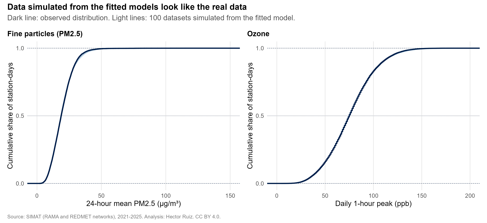
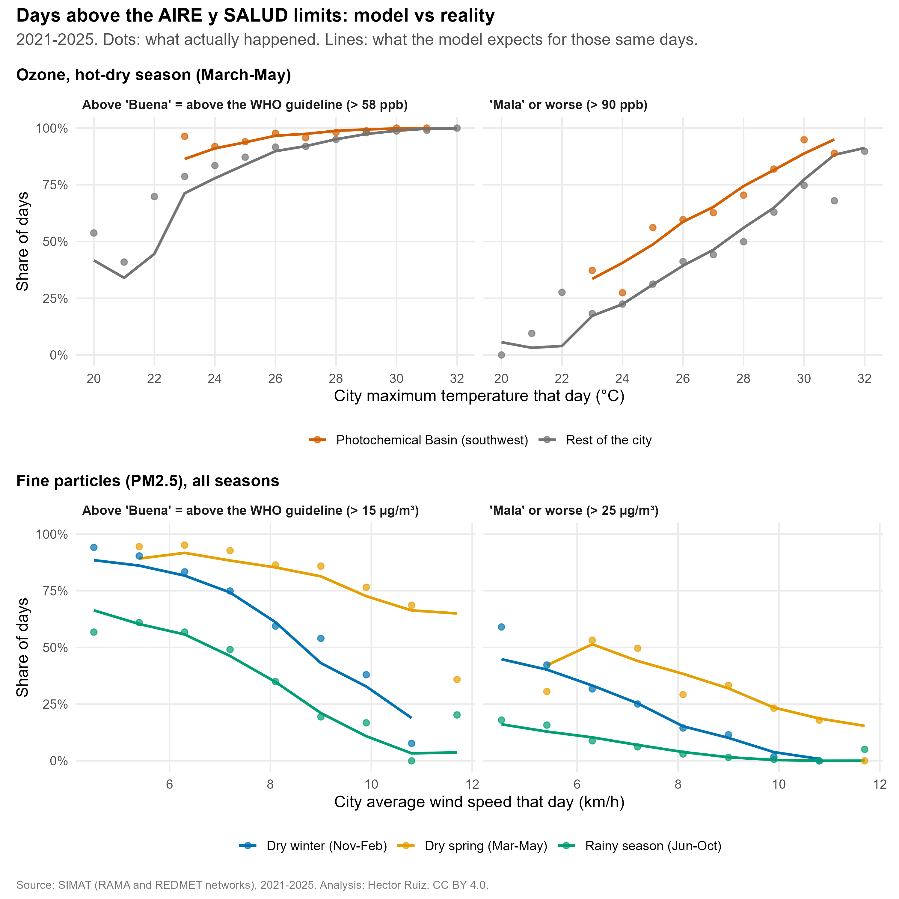
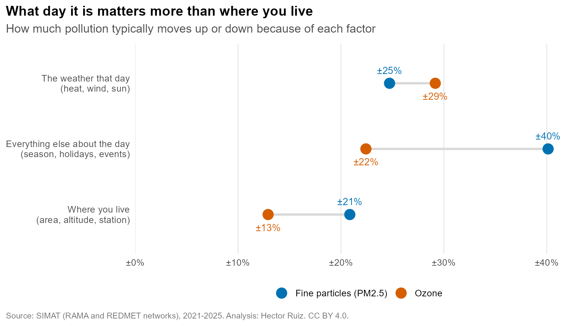
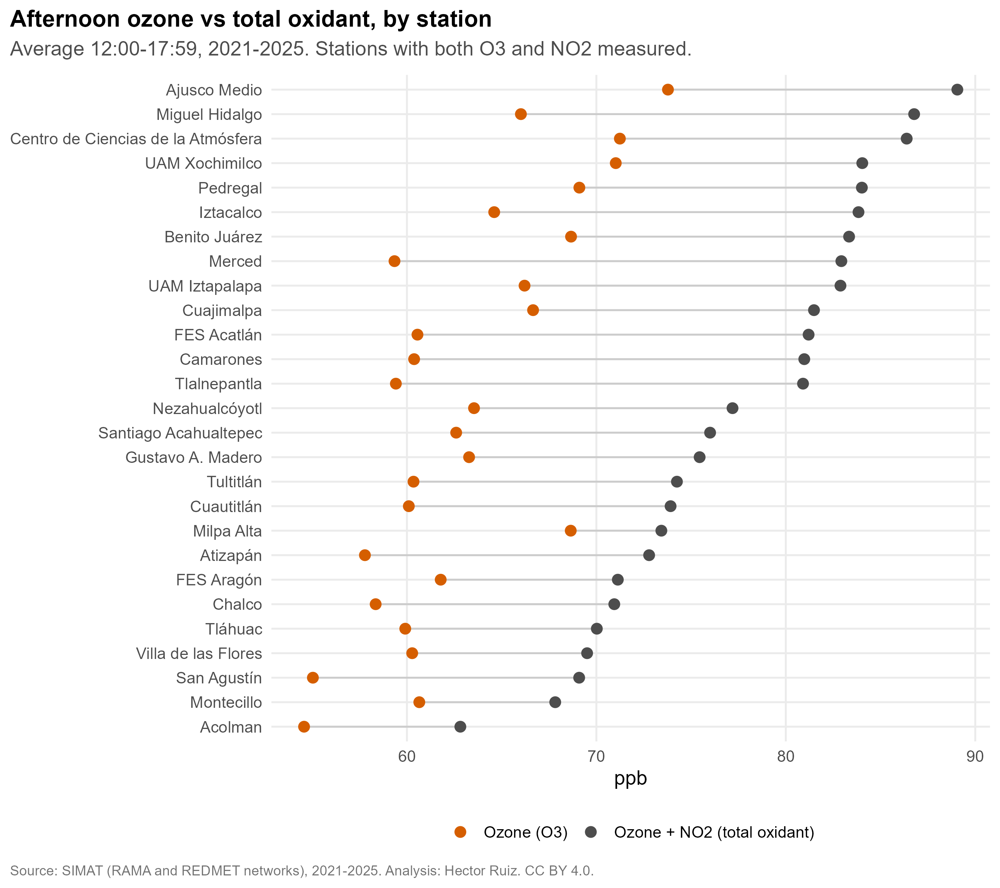

*By [Hector Ruiz](https://www.linkedin.com/in/hector-ruiz-g/)*

This appendix explains how the numbers in [the article](index.qmd) were produced, in roughly the order a skeptical reader would ask about them. It is not a replication package, but the code that matters is shown in folded blocks.

The analysis is observational. The model describes how pollution moves with weather, calendar, and place; it does not establish causes or estimate health effects. Every health figure in the article comes from published research, applied to these data as described in [the section on health numbers](#how-were-the-articles-health-and-timing-numbers-computed).

## What data, and what exactly was measured?

All monitoring data are hourly, from January 2021 to December 2025, from Mexico City's air quality monitoring system (SIMAT):

- **Pollutants:** ozone (O₃) and fine particles (PM2.5) from the [Red Automática de Monitoreo Atmosférico (RAMA)](http://www.aire.cdmx.gob.mx/default.php?opc=%27aKBhnmI=%27&opcion=Zg== "SIMAT. Red Automática de Monitoreo Atmosférico (RAMA): hourly pollutant data."). Its other gases (NO, NO₂, NOx, CO, PM10) were used only for descriptive checks.
- **Weather:** temperature, relative humidity, and wind from the [Red de Meteorología y Radiación Solar (REDMET)](http://www.aire.cdmx.gob.mx/default.php?opc=%27aKBi%27 "SIMAT. Red de Meteorología y Radiación Solar (REDMET): hourly weather and radiation data."), plus hourly UV-A sunlight at 11 stations.
- **Calendar:** the school calendars of the [Secretaría de Educación Pública](https://www.planeacion.sep.gob.mx/CalendarioHistorico.aspx "Secretaría de Educación Pública. Calendarios escolares históricos.") and federal holidays.
- **Stations:** altitude and land cover from SIMAT's [*Caracterización del Entorno Físico*](http://www.aire.cdmx.gob.mx/descargas/publicaciones/simat-entornos.pdf "SIMAT (2021). Caracterización del entorno físico de las estaciones de monitoreo."), which I also used to group stations into five urban environments.

The unit of analysis is the **station-day**, with daily metrics as in the official daily report of [NOM-172-SEMARNAT-2023](https://sinaica.inecc.gob.mx/archivo/noms/NOM-172-SEMARNAT-2023-Indice-AIRE-y-SALUD.pdf "NOM-172-SEMARNAT-2023. Lineamientos para la obtención y comunicación del índice de calidad del aire y riesgos a la salud. Diario Oficial de la Federación."): the day's highest one-hour value for ozone, and the 24-hour mean for PM2.5. A day counts only if at least 18 of its 24 hours are valid ([SIMAT's 75% rule](https://aire.cdmx.gob.mx/descargas/Opendata/catalogos/calculo-promedio-24-horas.pdf "SIMAT. Cálculo del promedio de 24 horas (criterio de suficiencia del 75%).")).

| | PM2.5 (24-hour mean, µg/m³) | Ozone (daily 1-hour peak, ppb) |
|:--|--:|--:|
| Station-days | 23,185 | 46,910 |
| Stations | 20 | 34 |
| Median | 18.8 | 75 |
| 95th percentile | 34.2 | 120 |
| Maximum | 115.1 | 187 |

The industrial north has eight ozone stations but only one PM2.5 station, so anything said about particles there rests on a single site.

## Can the raw files be trusted as published?

Mostly, after three corrections. None of them is documented by SIMAT; each was inferred from the data.

**Hour labels.** SIMAT labels each hourly average by the *end* of its hour; everything here is converted to start-of-hour labels. The 2025 pollutant file appears to label the *start* instead: its ozone daily cycle peaks and bottoms out exactly one hour earlier than in 2023 and 2024, so it was treated as start-labeled.

**"Stuck at 1" weather readings.** Some sensors report exactly 1 (1 °C, 1%, 1 m/s) for days or months, often in all variables at once; one central station sat at 1 °C for more than 5,000 hours. The value 1 seems to work as an undocumented "no data" code. A real reading can be 1 now and then, but not three hours in a row, so runs of three or more were set to missing. That removed about 4-6% of the weather readings, almost none of them in 2023, which suggests the pattern comes from how each year's file was produced.

```{r}
# 01_tidy.R: remove runs of 3+ consecutive hours at exactly 1 (per station)
clean_met = clean_met %>%
  arrange(id_station, date_day, hour) %>%
  group_by(id_station) %>%
  mutate(run_id = consecutive_id(value)) %>%   # same id for neighboring equal values
  group_by(id_station, run_id) %>%
  mutate(value = if_else(value == 1 & n() >= 3, NA_real_, value)) %>%
  ungroup()
```

**UV-A.** Where SIMAT publishes a year twice, the copy without stuck values was used. No station reported UV-A from June 1 to July 6, 2024; those 36 days take the same-date average of the other years and are flagged.

## Weather was often missing. How was that handled, and does it bias anything?

Weather gaps are the biggest data problem here. Most are dead station-years rather than scattered hours, and eight ozone stations have no weather sensor at all. Still, between 14 and 33 stations reported weather every single day.

Gaps of up to three hours are interpolated; longer gaps take the same-hour average of the other stations in the same urban environment, or failing that, of the whole city. Station-days with any borrowed hour (46% for PM2.5, 58% for ozone) are flagged, and the flag enters the model; its estimated effect is small.

```{r}
# 02_build_daily_model_data.R
# Step 1: short gaps (<= 3 hours) by straight-line interpolation
data = data %>%
  arrange(id_station, id_parameter, datetime) %>%
  group_by(id_station, id_parameter) %>%
  mutate(across(c(TMP, WSP, RH), ~ zoo::na.approx(.x, maxgap = 3, na.rm = FALSE))) %>%
  ungroup()

# Steps 2 and 3: same-hour average of the station's urban environment, then the city
station_weather = data %>% distinct(date_day, hour, id_station, archetype, TMP, WSP, RH)
arch_hourly = station_weather %>%
  group_by(date_day, hour, archetype) %>%
  summarize(z_TMP = mean(TMP, na.rm = TRUE), z_WSP = mean(WSP, na.rm = TRUE),
            z_RH = mean(RH, na.rm = TRUE), .groups = "drop")
city_hourly = station_weather %>%
  group_by(date_day, hour) %>%
  summarize(c_TMP = mean(TMP, na.rm = TRUE), c_WSP = mean(WSP, na.rm = TRUE),
            c_RH = mean(RH, na.rm = TRUE), .groups = "drop")

data = data %>%
  left_join(arch_hourly, by = c("date_day", "hour", "archetype")) %>%
  left_join(city_hourly, by = c("date_day", "hour")) %>%
  mutate(TMP = coalesce(TMP, z_TMP, c_TMP),
         WSP = coalesce(WSP, z_WSP, c_WSP),
         RH  = coalesce(RH,  z_RH,  c_RH))
```

To test the borrowed values, a leave-one-out check hides each station's own weather, fills it the same way from the other stations, and compares the filled day with the real one:

| Daily value | Station-days | Bias (borrowed - real) | Mean absolute error | Correlation |
|:--|--:|--:|--:|--:|
| Maximum temperature | 31,093 | -0.11 °C | 1.69 °C | 0.77 |
| Mean wind speed | 34,488 | 0.00 m/s | 0.45 m/s | 0.55 |

```{r}
# 02b_explore_daily_data.R: leave-one-out check of borrowed weather
# Leave-one-out average = (sum of everyone - my own value) / (count - 1)
loo = met %>%
  group_by(date_day, hour, id_parameter, archetype) %>%
  mutate(n_arch = sum(!is.na(value)), sum_arch = sum(value, na.rm = TRUE)) %>%
  group_by(date_day, hour, id_parameter) %>%
  mutate(n_city = sum(!is.na(value)), sum_city = sum(value, na.rm = TRUE)) %>%
  ungroup() %>%
  mutate(
    own = !is.na(value),
    own_value = if_else(own, value, 0),
    arch_loo = (sum_arch - own_value) / (n_arch - own),   # NaN/Inf when nobody else reported
    city_loo = (sum_city - own_value) / (n_city - own),
    borrowed = if_else(is.finite(arch_loo), arch_loo, city_loo)
  )
# then: daily max (temperature) or daily mean (wind) of real vs borrowed hours,
# on station-days with at least 18 real and 18 borrowed hours
```

Borrowed weather is unbiased on average but imprecise for any one station. That is why the model splits each weather variable in two:

- **City-wide weather**, the average over all stations that day. It rests on 14 to 33 stations, so it is robust to any one station's gaps, and it is what a forecast tells you.
- **Local deviation**, the station's value minus the city average. Borrowed values pull it toward zero.

```{r}
# 02_build_daily_model_data.R: city-wide and local parts of each weather variable
city_weather = daily_metrics %>%
  distinct(date_day, id_station, daily_max_temp, daily_mean_wind, daily_mean_rh) %>%
  group_by(date_day) %>%
  summarize(city_max_temp  = mean(daily_max_temp,  na.rm = TRUE),
            city_mean_wind = mean(daily_mean_wind, na.rm = TRUE),
            city_mean_rh   = mean(daily_mean_rh,   na.rm = TRUE), .groups = "drop")

daily_metrics = daily_metrics %>%
  left_join(city_weather, by = "date_day") %>%
  mutate(dev_temp = daily_max_temp  - city_max_temp,
         dev_wind = daily_mean_wind - city_mean_wind,
         dev_rh   = daily_mean_rh   - city_mean_rh)
```

The split also matters for the model: its baseline per date (below) would otherwise absorb anything the whole city shares that day, including the weather. The upshot is that **the city-wide weather effects are well identified, and the local ones are noisier and probably understated.** UV-A enters only as a city-wide term, since 11 stations are too few for a local one.

## How were school days, holidays, and fireworks defined?

Each date is labeled from the SEP calendars and federal holidays. Because day of the week is in the model, the school-day effect compares school days with **weekdays without school**. January to August 2021, when the calendar said school but classes were online, gets its own flag. December 25 and January 1 are split from the other holidays as **fireworks days**: the Christmas Eve and New Year's Eve fireworks go off around midnight, so their smoke lands on those dates.

## What is the model, and why this one?

Both pollutants get the same kind of model, fitted separately with [brms](https://paulbuerkner.com/brms/ "Bürkner, P.-C. (2017). brms: An R package for Bayesian multilevel models using Stan. Journal of Statistical Software, 80(1).") and Stan. Concentrations are positive and right-skewed, so each daily value is lognormal, and coefficients are multiplicative (0.1 ≈ 10% higher):

$$
\log y_{sd} \sim \text{Normal}(\mu_{sd}, \sigma), \qquad
\mu_{sd} = \mathbf{x}_{sd}^{\top}\boldsymbol\beta + u_s + w_{\text{week}(d)} + v_d
$$

$$
u_s \sim \text{Normal}(0, \tau_{\text{station}}), \quad
w_k \sim \text{Normal}(0, \tau_{\text{week}}), \quad
v_d \sim \text{Normal}(0, \tau_{\text{date}})
$$

where $s$ is the station and $d$ the date. The fixed part holds city-wide and local weather, midday UV-A, season, day of the week, the calendar flags, year, altitude, urban environment, and the borrowed-weather flag. Each group-level term has a job:

- **Date** ($v_d$): every station measures the same city on the same day. Without this term, 30 stations on one day would count as 30 independent observations, and the intervals for anything that varies by date would be far too narrow. It also absorbs what isn't measured, such as inversions or regional smoke.
- **Week** ($w_k$): pollution episodes last several days. Without this term, neighboring days' date baselines were correlated (about 0.45); adding it widened the intervals of season, year, and city temperature by 30-50%, the honest price of that dependence.
- **Station** ($u_s$): stations differ even within the same environment.

The five urban environments enter as fixed effects (five groups are too few to estimate a spread), and so does year, to absorb trends. Each model also tests one interaction chosen in advance: whether wind clears PM2.5 equally well in every season, and whether the school-day effect on ozone changes with heat.

```{r}
# 03_model_spec.R: final formulas (continuous predictors are z-scores)
pm25_formula = bf(
  daily_metric ~ season * z_wind_city + z_wind_dev +
    z_temp_city + z_temp_dev + z_rh_city + z_rh_dev + z_uva_city +
    day_of_week_f + is_school_day + is_fireworks + is_holiday_other + is_remote_school +
    is_imputed_met + year_f + z_alt + archetype +
    (1 | id_station) + (1 | week_id) + (1 | date_id)
)

o3_formula = bf(
  daily_metric ~ season + is_school_day * z_temp_city + z_temp_dev +
    z_wind_city + z_wind_dev + z_rh_city + z_rh_dev + z_uva_city +
    day_of_week_f + is_fireworks + is_holiday_other + is_remote_school +
    is_imputed_met + year_f + z_alt + archetype +
    (1 | id_station) + (1 | week_id) + (1 | date_id)
)
```

Priors are weakly informative on the log scale: intercepts centered on typical values, normal(0, 0.3) for coefficients (most effects between about -45% and +80%), and exponential(3) for group-level standard deviations.

```{r}
# 03_model_spec.R: priors (log scale)
pm25_priors = c(
  prior(normal(2.9, 0.3), class = "Intercept"),   # exp(2.9) ~ 18 µg/m³
  prior(normal(0, 0.3),   class = "b"),           # most effects within -45% to +80%
  prior(exponential(3),   class = "sd"),          # station, week and date spreads
  prior(normal(0, 0.5),   class = "sigma", lb = 0)
)
o3_priors = c(
  prior(normal(4.3, 0.3), class = "Intercept"),   # exp(4.3) ~ 74 ppb
  prior(normal(0, 0.3),   class = "b"),
  prior(exponential(3),   class = "sd"),
  prior(normal(0, 0.5),   class = "sigma", lb = 0)
)
```

Data simulated from the priors alone match the observed medians but have far heavier tails, as intended; after fitting, the posterior standard deviations of the fixed effects are at most a third of the prior ones. The final model is the last of four planned steps (place and calendar only, then weather, then the interactions, then the week term, fireworks split, and UV-A), and the spread of the date baselines shrank as measured weather took over (PM2.5: 0.35 to 0.23; ozone: 0.30 to 0.16). Refitting the step-3 ozone model with a Gamma family left the coefficients essentially unchanged.

## Did the sampler work?

```{r}
# 03b_Bayesian full models.R: sampler settings for every fit
brm(formula, data, family = lognormal(), prior = priors,
    chains = 4, cores = 4, threads = threading(3),
    iter = 6000, warmup = 2000, thin = 2, seed = 123,
    control = list(adapt_delta = 0.95), backend = "cmdstanr")
```

The long chains are deliberate: moving any date-level coefficient means hundreds of date baselines must shift together, and a first attempt with 2,000 iterations left those terms with effective sample sizes near 110-150. Each final model keeps 8,000 draws:

```{r}
#| eval: true
#| echo: false
library(tidyverse)
library(knitr)
read_csv("plots/final/appendix/04_sampler_diagnostics.csv", show_col_types = FALSE) %>%
  transmute(
    Model = model,
    Parameters = n_parameters,
    `Max R̂` = max_rhat,
    `Min effective sample size` = min_ess,
    `Divergent transitions` = divergences,
    `% at max tree depth` = pct_max_treedepth,
    `E-BFMI (min to max)` = paste(min_bfmi, "to", max_bfmi)
  ) %>%
  kable(align = "lrrrrrr")
```

## Does the model reproduce the data?

Data simulated from the fitted model closely match the real distribution for both pollutants:

{fig-alt="Two cumulative distribution plots, one per pollutant, where the observed curve sits inside the band of simulated curves."}

By season and urban environment, the medians and 95th percentiles are within 3.5% of the observed values, except for these, where the model runs high on the worst PM2.5 days (positive = model higher; 200 posterior draws):

| Group | Statistic | Observed | Simulated (95% range) | % off |
|:--|:--|--:|--:|--:|
| PM2.5, industrial north (one station) | 95th percentile | 34.1 | 38.8-41.2 | +17.1 |
| PM2.5, urban core | 95th percentile | 34.8 | 37.4-38.8 | +9.6 |
| PM2.5, dry spring (Mar-May) | 95th percentile | 37.9 | 40.0-41.3 | +7.4 |

The spring miss is worth keeping in mind when reading the article's wind chart, whose spring line comes from the same model. Residuals have a standard deviation of about 0.17 on the log scale (±17%), and a station's consecutive days remain correlated (median lag-1 correlation 0.52 for PM2.5, 0.36 for ozone), so intervals for station-level comparisons are somewhat too narrow. The largest single misses are fireworks days at hill stations, which get far less smoke than the city-wide fireworks term assumes.

The article's probabilities of a *Mala* day were checked against the observed share in each temperature or wind bin. The model is off by 0.053 for ozone and 0.033 for PM2.5 on average (0-1 scale), with the largest gap in the rest of the city at 31 °C (0.88 predicted, 0.68 observed):

{fig-alt="Two panels comparing predicted and observed shares of Mala days. Ozone by daily high temperature, for the southwest basin and the rest of the city; PM2.5 by wind speed, by season. Model and observations track each other closely."}

## What did the model find?

Each row answers: *if this one thing changes and everything else stays as it was, how much does the expected level change, on average?* Effects are computed over 1,000 sampled station-days per pollutant, without the station, week, and date baselines, with 95% credible intervals; continuous effects are per unit. Year and urban-environment terms are controls and are omitted, and the two place contrasts the article uses are shown instead.

```{r}
#| eval: true
#| echo: false
read_csv("plots/final/appendix/04_effects_table.csv", show_col_types = FALSE) %>%
  transmute(
    Pollutant,
    Effect = Driver,
    `Change (units)` = sprintf("%.2f (%.2f to %.2f)", Absolute_Shift, `95%_CI_Lower`, `95%_CI_Upper`),
    `Change (%)` = sprintf("%+.1f%% (%.1f to %.1f)", Pct_Change, Pct_Low, Pct_High),
    Interval = Credible_Interval_Status
  ) %>%
  kable(align = "llrrl")
```

```{r}
# 04_Bayesian visualize.R: effects in real units
re_none = NA   # population-level predictions: no station, week or date baselines
set.seed(123)
pm25_sample = pm25_data %>% slice_sample(n = 1000)
pm25_eff = avg_comparisons(m_pm25, newdata = pm25_sample, re_formula = re_none)
pm25_rat = avg_comparisons(m_pm25, newdata = pm25_sample, re_formula = re_none,
                           comparison = "ratioavg")
# z-scored terms: the +1 SD change is divided by the SD for "per unit";
# ratios become % per unit as 100 * (ratio^(1 / SD) - 1)
```

Sunlight and heat move together (correlation 0.71), so their separate ozone effects are less certain than they look; their combined effect is the solid finding.

**The day versus the place.** Each block of the model's linear predictor was summarized by its standard deviation across station-days on the log scale, expressed as a typical swing, exp(sd) - 1, with blocks combined in quadrature (an approximation that treats them as independent):

{fig-alt="Bar chart comparing the typical swing in each pollutant explained by the weather that day, everything else about the day, and where you live. For both pollutants, the day explains more than the place."}

**Place.** Only two place contrasts are large and consistent enough to report: southwest basin stations average 12.4 ppb (17%) more ozone than the rest of the city, and stations at 2,300 m and above average 4.4 µg/m³ (22%) less PM2.5 than the valley floor. Their narrow intervals are conditional on these particular stations.

**School days.** On average, school days change neither pollutant detectably. For ozone, they are 2-5 ppb lower on cool days (credible below about 24 °C) and no different on hot ones. The 2021 remote-school period shows no effect either, but without a pre-pandemic baseline it can't say whether less commuting cleans the air.

**Traffic markers.** Gases that come almost entirely from exhaust measure traffic directly, so they show how much PM2.5 responds to a real drop in traffic. Morning rush (6:00-9:59) averages, with 95% block-bootstrap intervals:

```{r}
#| eval: true
#| echo: false
read_csv("plots/final/appendix/02c_traffic_markers.csv", show_col_types = FALSE) %>%
  transmute(
    Marker = marker,
    Comparison = comparison,
    `Difference (%)` = sprintf("%+.1f (%.1f to %.1f)", pct, low, high),
    Days = days
  ) %>%
  kable(align = "llrr")
```

**Ozone near traffic.** Fresh exhaust (NO) turns ozone into NO₂, so the total oxidant (Ox = O₃ + NO₂) is a fairer comparison between stations. Across stations, afternoon ozone correlates -0.46 with morning NO, while Ox doesn't correlate with it at all (-0.01). Merced, in the center, has some of the lowest ozone (59 ppb) but an Ox of 83 ppb, close to Ajusco Medio (89 ppb), the highest.

{fig-alt="Station-by-station chart of afternoon ozone and nitrogen dioxide. Central stations have less ozone but more nitrogen dioxide, so their total oxidant is similar to the southwest."}

## How were the article's health and timing numbers computed?

These are descriptive summaries of the station data combined with published figures, not model outputs.

**Thresholds.** The categories come from [NOM-172-SEMARNAT-2023](https://sinaica.inecc.gob.mx/archivo/noms/NOM-172-SEMARNAT-2023-Indice-AIRE-y-SALUD.pdf "NOM-172-SEMARNAT-2023. Lineamientos para la obtención y comunicación del índice de calidad del aire y riesgos a la salud. Diario Oficial de la Federación."). The top of *Aceptable* equals the legal limits of [NOM-025-SSA1-2021](http://www.aire.cdmx.gob.mx/descargas/monitoreo/normatividad/NOM-025-SSA1-2021.pdf "NOM-025-SSA1-2021. Salud ambiental. Criterio para evaluar la calidad del aire ambiente, con respecto a las partículas suspendidas PM10 y PM2.5. Diario Oficial de la Federación.") and [NOM-020-SSA1-2021](http://www.aire.cdmx.gob.mx/descargas/monitoreo/normatividad/NOM-020-SSA1-2021.pdf "NOM-020-SSA1-2021. Salud ambiental. Criterio para evaluar la calidad del aire ambiente, con respecto al ozono (O3). Diario Oficial de la Federación."). The PM2.5 limit is being phased in (41, then 33, then 25 µg/m³ since January 2026), and the article uses 25.

| Category | Ozone, 1-hour (ppb) | PM2.5, 24-hour (µg/m³) |
|:--|--:|--:|
| *Buena* | up to 58 | up to 15 |
| *Aceptable* | 58-90 | 15-25 |
| *Mala* | 90-135 | 25-79 |
| *Muy mala* | 135-175 | 79-130 |

The top of *Buena* matches the [WHO 2021 guidelines](https://iris.who.int/server/api/core/bitstreams/551b515e-2a32-4e1a-a58c-cdaecd395b19/content "World Health Organization (2021). WHO global air quality guidelines: particulate matter (PM2.5 and PM10), ozone, nitrogen dioxide, sulfur dioxide and carbon monoxide. Geneva: WHO."): directly for PM2.5 (15 µg/m³), and for ozone through NOM-172's factor of 1.14, which converts the WHO's 8-hour value (about 51 ppb) to 58 ppb over one hour. In these data, though, the 1-hour peak is a median 1.28 times the highest 8-hour average, so the 1-hour test is stricter: 75% of station-days exceed 58 ppb, but 64% fail the WHO's own 8-hour test. The article's "two out of three" uses the WHO's test. Both WHO short-term guidelines allow three or four exceedance days a year.

**Share of the long-term harm.** For each PM2.5 station-day, the excess above the WHO annual guideline (5 µg/m³) was summed by category, which assumes harm grows linearly with concentration, as the AQLI method does.

| Category | Share of station-days | Share of the excess |
|:--|--:|--:|
| *Buena* | 31.9% | 13.0% |
| *Aceptable* | 44.3% | 44.5% |
| *Mala* | 23.7% | 42.2% |
| *Muy mala* | 0.1% | 0.3% |

**Life expectancy.** The [Air Quality Life Index](https://aqli.epic.uchicago.edu/files/Report%20-%20English%20Global%20View.pdf "Energy Policy Institute at the University of Chicago (2025). Air Quality Life Index: Annual Update.") turns [Ebenstein et al. (2017)](https://pmc.ncbi.nlm.nih.gov/articles/PMC5625887/pdf/pnas.201616784.pdf "Ebenstein, A., Fan, M., Greenstone, M., He, G., & Zhou, M. (2017). New evidence on the impact of sustained exposure to air pollution on life expectancy from China's Huai River Policy. PNAS.") into 0.98 years of life expectancy per 10 µg/m³ of lifelong PM2.5. Ebenstein's own estimate is 0.64 years per 10 µg/m³ of PM10 (95% CI 0.21 to 1.07); scaling that interval by AQLI's factor (0.98 / 0.64) gives the range.

```{r}
# 05_article_charts.R: years of life expectancy lost vs the WHO annual guideline
city_mean = 19.8                                     # mean of station annual means
years_lost = function(per_10) (city_mean - 5) * per_10 / 10
years_lost(0.98)                                     # 1.45 (central)
years_lost(0.21 * 0.98 / 0.64)                       # 0.48 (low)
years_lost(1.07 * 0.98 / 0.64)                       # 2.42 (high)
```

The city mean of 19.8 µg/m³ (station-years from 12.4 to 25.1) is close to AQLI's satellite values for Mexico City (20.6 to 21.5 in 2021-2023), and AQLI's own estimate for the city is 1.6 years ([country page](https://aqli.epic.uchicago.edu/countryPage/M%C3%A9xico "Energy Policy Institute at the University of Chicago. Air Quality Life Index, country page: México.")). Capping every day above 25 µg/m³ at 25 lowers the figure only from 1.44 to 1.29 years; cutting every day by 20% lowers it to 1.05.

**Time of day.** The timing figures are city averages of the hourly values by season, without the model, comparing 19:00-20:59 with 9:00 for PM2.5, and 6:00-7:59 with 14:00 for ozone.

## What this analysis can't tell you

**Associations, not causes.** The model describes how pollution moves with weather, calendar, and place. The article's mechanisms (the inversion lid, ozone forming downwind, spring fire smoke) are explanations consistent with the data and with the [city's air quality program](https://www.aire.cdmx.gob.mx/descargas/publicaciones/flippingbook/proaire2021-2030/pdf/CapitulosVersionCompleta-ProAireZMVM2021-2030/ProAireZMVM2021-2030-Capitulo3.pdf "ProAire ZMVM 2021-2030. Programa de Gestión para Mejorar la Calidad del Aire de la Zona Metropolitana del Valle de México, capítulo 3: Diagnóstico de la calidad del aire."), not things the model observes.

**Mass, not chemistry.** RAMA measures particle mass. Soot, dust, sulfate, and fireworks smoke count the same here, though they likely differ in toxicity.

**Stations, not lungs.** Stations measure above street level, where readings are usually lower than at the curb; in [Velasco et al. (2019)](https://www.sciencedirect.com/science/article/abs/pii/S1352231019306831 "Velasco, E., et al. (2019). Particle exposure and inhaled dose while commuting by public transport in Mexico City. Atmospheric Environment, 117044."), a park off Avenida Cuauhtémoc read 35 µg/m³ while the official station under a kilometer away read 26.

**Borrowed evidence.** The life-expectancy coefficient comes from China and a different particle mix. Velasco et al. measured one route at midday over two weeks of the dry season. Tainio et al.'s exercise break-even uses urban-background levels, and Mexico City's altitude raises the air breathed for a given effort somewhat.

## What I considered and left out

**Five urban environments as a headline.** The grouping stays in the model as a control, but once altitude and each station's baseline are accounted for, three of the five barely differ. Station baselines show no relationship with built-up or vegetated land cover (r ≈ 0), so census-based measures of urban form weren't pursued either.

**More models.** Separate models of total oxidant or PM10, or a joint model of both pollutants, would each answer a narrower question. The two models' unexplained date baselines correlate at 0.60, so bad days for one tend to be bad for the other; a joint model would formalize that link without changing any finding.

**Specific sources.** Attributing pollution to the Tula refinery and power plant, or to household wood and charcoal, would need source-apportionment data this analysis doesn't have.

## Software and reproducibility

The analysis runs as a sequence of R scripts: `00_calendarios.R` (school calendar), `01_tidy.R` (cleaning), `02_build_daily_model_data.R` (gap filling and model datasets), `02b` and `02c` (exploratory and descriptive checks), `03a` (prior simulation), `03b` (model fits), `04` (diagnostics, effects, calibration), and `05` (article charts and health numbers), with seeds fixed at 123.

It was built in [R](https://www.r-project.org/ "R Core Team (2025). R: A language and environment for statistical computing. R Foundation for Statistical Computing, Vienna.") 4.5.1. The models were fitted in [Stan](https://mc-stan.org/ "Stan Development Team. CmdStan: the command-line interface to Stan.") (CmdStan 2.40.0) through [brms](https://paulbuerkner.com/brms/ "Bürkner, P.-C. (2017). brms: An R package for Bayesian multilevel models using Stan. Journal of Statistical Software, 80(1).") 2.23.0 and [cmdstanr](https://mc-stan.org/cmdstanr/ "Gabry, J., Češnovar, R., Johnson, A., & Bronder, S. cmdstanr: R interface to CmdStan.") 0.9.0, and checked with [posterior](https://mc-stan.org/posterior/ "Bürkner, P.-C., Gabry, J., Kay, M., & Vehtari, A. posterior: Tools for working with posterior distributions.") 1.7.0 and [bayesplot](https://mc-stan.org/bayesplot/ "Gabry, J., & Mahr, T. bayesplot: Plotting for Bayesian models.") 1.16.0. Effects were computed with [marginaleffects](https://marginaleffects.com/ "Arel-Bundock, V., Greifer, N., & Heiss, A. (2024). How to interpret statistical models using marginaleffects for R and Python. Journal of Statistical Software, 111(9).") 1.0.0. Data handling used the [tidyverse](https://www.tidyverse.org/ "Wickham, H., et al. (2019). Welcome to the tidyverse. Journal of Open Source Software, 4(43), 1686.") 2.0.0, [zoo](https://cran.r-project.org/package=zoo "Zeileis, A., & Grothendieck, G. (2005). zoo: S3 infrastructure for regular and irregular time series. Journal of Statistical Software, 14(6).") 1.9.1, and [slider](https://slider.r-lib.org/ "Vaughan, D. slider: Sliding window functions.") 0.3.3; charts used [patchwork](https://patchwork.data-imaginist.com/ "Pedersen, T. L. patchwork: The composer of plots.") 1.3.2, and this page's tables [knitr](https://yihui.org/knitr/ "Xie, Y. knitr: A general-purpose package for dynamic report generation in R.").

Questions are welcome; you can reach me on [LinkedIn](https://www.linkedin.com/in/hector-ruiz-g/).
