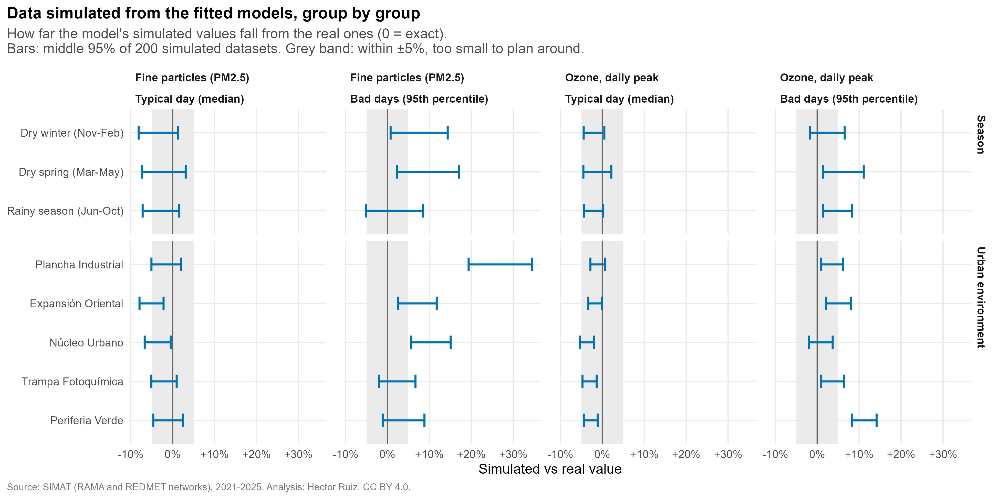
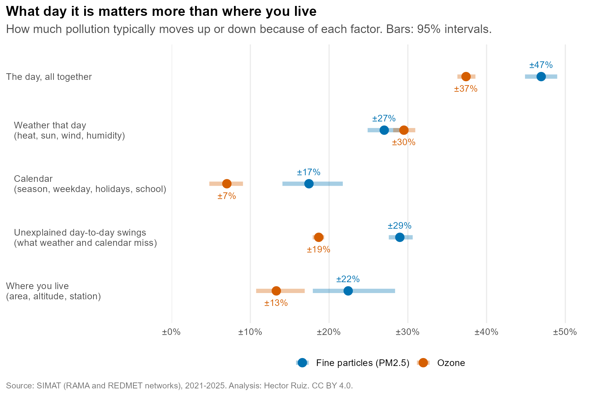
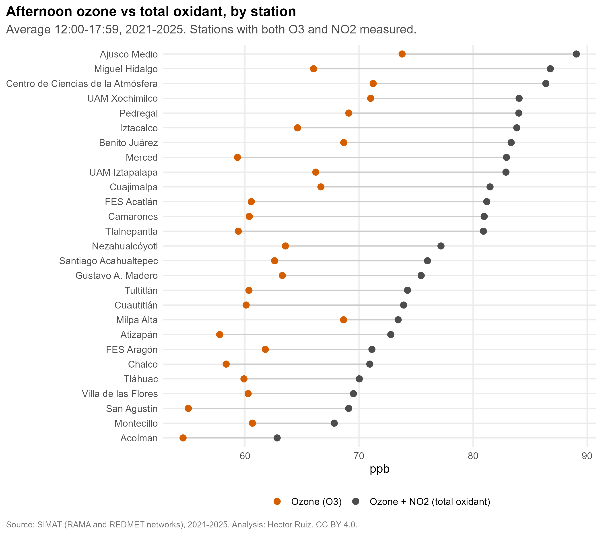

*By [Hector Ruiz](https://www.linkedin.com/in/hector-ruiz-g/)*

This appendix explains how the numbers in [the article](index.qmd) were produced, in roughly the order a skeptical reader would ask about them. It is not a replication package, but the code that matters is shown in folded blocks.

The analysis is observational. The model describes how pollution moves with weather, calendar, and place; it does not establish causes or estimate health effects. Every health figure in the article comes from published research, applied to these data as described in [the section on health numbers](#how-were-the-articles-health-and-timing-numbers-computed).

## What each claim rests on

| Claim in the article | Rests on | Strength | Main caveat |
|:--|:--|:--|:--|
| Particles peak mid-morning, ozone early afternoon; evenings have about 30% fewer particles | Hourly city averages | Strong | City average, not your street |
| Hot, sunny spring days bring more *Mala* ozone days | Daily shares by temperature; model about +6% per °C, +11% for a hot, bright spring day | Strong | Heat and sun move together |
| Rainy season: particles about a third lower, ozone about as high as in winter | Seasonal city averages | Strong | Season, not rain itself |
| Wind clears particles far less in spring | Model | Moderate | Spring interval is wide (3% to 15%) |
| January 1 is the dirtiest day for particles | Daily data, 2022-2025 | Strong | Four winters |
| Quiet Sundays cut exhaust far more than particles | Morning-rush averages, block bootstrap | Strong | Mornings only |
| The day matters more than the neighborhood | Model variance split | Strong in direction | The split is approximate |
| Southwest ozone +17%, hill particles -21% | Model, by station | Moderate to strong | About ±10% for a place without a station |
| The center's low ozone is partly hidden by exhaust | Ozone + NO₂ by station | Moderate | 27 stations, descriptive |
| Bad days come in runs; for particles, yesterday is as good a guide as the weather | Daily data; forecasts of years the model hadn't seen | Strong | Station-level |
| *Aceptable* days carry almost half the long-term toll | Station data | Moderate | Assumes harm grows linearly |
| About 1.5 years of life expectancy | Published estimates × station data | Indicative | Range 0.5 to 2.5 years; borrowed from other countries |
| Exercise away from traffic and around ozone; box-fan filter; fitted masks | Published studies | Moderate | Measured in other cities; fit and seal matter |

"Strong" means the claim follows directly from the measurements or holds under every check here. "Moderate" means it depends on the model or on studies done elsewhere. "Indicative" means the size is uncertain, though the direction is not.

## What data, and what exactly was measured?

All monitoring data are hourly, from Mexico City's air quality monitoring system (SIMAT). The model is fitted on January 2021 to December 2025; January to July 2026, published later, is used only to test it:

- **Pollutants:** ozone (O₃) and fine particles (PM2.5) from the [Red Automática de Monitoreo Atmosférico (RAMA)](http://www.aire.cdmx.gob.mx/default.php?opc=%27aKBhnmI=%27&opcion=Zg== "SIMAT. Red Automática de Monitoreo Atmosférico (RAMA): hourly pollutant data."). Its other gases (NO, NO₂, NOx, CO, PM10) were used only for descriptive checks.
- **Weather:** temperature, relative humidity, and wind from the [Red de Meteorología y Radiación Solar (REDMET)](http://www.aire.cdmx.gob.mx/default.php?opc=%27aKBi%27 "SIMAT. Red de Meteorología y Radiación Solar (REDMET): hourly weather and radiation data."), plus hourly UV-A sunlight at 11 stations.
- **Calendar:** the school calendars of the [Secretaría de Educación Pública](https://www.planeacion.sep.gob.mx/CalendarioHistorico.aspx "Secretaría de Educación Pública. Calendarios escolares históricos.") and federal holidays.
- **Stations:** altitude and land cover from SIMAT's [*Caracterización del Entorno Físico*](http://www.aire.cdmx.gob.mx/descargas/publicaciones/simat-entornos.pdf "SIMAT (2021). Caracterización del entorno físico de las estaciones de monitoreo."), which I also used to group stations into five urban environments.

The unit of analysis is the **station-day**, with daily metrics as in the official daily report of [NOM-172-SEMARNAT-2023](https://sinaica.inecc.gob.mx/archivo/noms/NOM-172-SEMARNAT-2023-Indice-AIRE-y-SALUD.pdf "NOM-172-SEMARNAT-2023. Lineamientos para la obtención y comunicación del índice de calidad del aire y riesgos a la salud. Diario Oficial de la Federación."): the day's highest one-hour value for ozone, and the 24-hour mean for PM2.5. A day counts only if at least 18 of its 24 hours are valid ([SIMAT's 75% rule](https://aire.cdmx.gob.mx/descargas/Opendata/catalogos/calculo-promedio-24-horas.pdf "SIMAT. Cálculo del promedio de 24 horas (criterio de suficiencia del 75%).")).

| | PM2.5 (24-hour mean, µg/m³) | Ozone (daily 1-hour peak, ppb) |
|:--|--:|--:|
| Station-days | 23,185 | 46,910 |
| Stations | 20 | 34 |
| Median | 18.8 | 75 |
| 95th percentile | 34.2 | 120 |
| Maximum | 115.1 | 187 |

The industrial north has eight ozone stations but only one PM2.5 station, so anything said about particles there rests on a single site.

## Can the raw files be trusted as published?

Mostly, after four corrections. None of them is documented by SIMAT; each was inferred from the data.

**Hour labels.** SIMAT labels each hourly average by the *end* of its hour; everything here is converted to start-of-hour labels. The 2025 pollutant file appears to label the *start* instead: its ozone daily cycle peaks and bottoms out exactly one hour earlier than in 2023 and 2024, so it was treated as start-labeled.

**"Stuck at 1" weather readings.** Some sensors report exactly 1 (1 °C, 1%, 1 m/s) for days or months, often in all variables at once; one central station sat at 1 °C for more than 5,000 hours. The value 1 seems to work as an undocumented "no data" code. A real reading can be 1 now and then, but not three hours in a row, so runs of three or more were set to missing. That removed about 4-6% of the weather readings, almost none of them in 2023, which suggests the pattern comes from how each year's file was produced.

**"Stuck at 1" pollutant readings in 2026.** The 2026 files, which come in a different format (one spreadsheet per pollutant, with the same hour convention as the weather files, checked against the ozone daily cycle), show the same pattern in the pollutant data: two ozone stations read exactly 1 ppb for up to 13 days in a row. Real readings of exactly 1 do occur (ozone at night in the center, where exhaust uses it up), but in 2021-2025 they never lasted longer than 15 hours for ozone or 9 hours for PM2.5, so longer runs were set to missing. That removed about 6,600 hours in 2026 and none in 2021-2025.

**UV-A.** Where SIMAT publishes a year twice, the copy without stuck values was used. No station reported UV-A from June 1 to July 6, 2024; those 36 days take the same-date average of the other years and are flagged.

## Weather was often missing. How was that handled, and does it bias anything?

Weather gaps are the biggest data problem here. Most are dead station-years rather than scattered hours, and eight ozone stations have no weather sensor at all. Still, between 14 and 33 stations reported weather every single day.

Gaps of up to three hours are interpolated; longer gaps take the same-hour average of the other stations in the same urban environment, or failing that, of the whole city. Station-days with any borrowed hour (46% for PM2.5, 58% for ozone) are flagged, and the flag enters the model; its estimated effect is small. Refitting an earlier one-piece version of the model without any borrowed-weather station-days moved no effect the article uses by more than 5 percentage points; the local wind term grew by about half, as expected if borrowed values blur the difference between a station and the city.

To test the borrowed values, a leave-one-out check hides each station's own weather, fills it the same way from the other stations, and compares the filled day with the real one:

| Daily value | Station-days | Bias (borrowed - real) | Mean absolute error | Correlation |
|:--|--:|--:|--:|--:|
| Maximum temperature | 31,093 | -0.11 °C | 1.69 °C | 0.77 |
| Mean wind speed | 34,488 | 0.00 m/s | 0.45 m/s | 0.55 |

Borrowed weather is unbiased on average but imprecise for any one station. That is why the model splits each weather variable in two:

- **City-wide weather**, the average over all stations that day. It rests on 14 to 33 stations, so it is robust to any one station's gaps, and it is what a forecast tells you.
- **Local deviation**, the station's value minus the city average. Borrowed values pull it toward zero.

The split also matters for the model: its term per day (below) absorbs anything the whole city shares that day, so city-wide weather can only be studied at the level of days. The upshot is that **the city-wide weather effects are well identified, and the local ones are noisier and probably understated.** UV-A enters only as a city-wide term, since 11 stations are too few for a local one.

## How were school days, holidays, and fireworks defined?

Each date is labeled from the SEP calendars and federal holidays. Because day of the week is in the model, the school-day effect compares school days with **weekdays without school**. January to August 2021, when the calendar said school but classes were online, gets its own flag. December 25 and January 1 are split from the other holidays as **fireworks days**: the Christmas Eve and New Year's Eve fireworks go off around midnight, so their smoke lands on those dates.

## What is the model, and why this one?

The data form a grid of days by stations, and that shapes everything. What the article says about *when* (weather, season, calendar) varies only from day to day, so it rests on about 1,800 days, not on the 23,000 to 47,000 station-days. What it says about *where* rests on 20 to 34 stations. Each day is measured by a median of 13 stations for PM2.5 and 26 for ozone, and each station has about 1,300 days, so both a day's level and a station's level are pinned down precisely. The model uses that structure in three stages. Everything is on the log scale, where daily values are close to normal and effects are multiplicative (0.1 ≈ 10% higher):

1. **Days and stations.** One regression of each station-day's log value on a term for every day, a term for every station, and the local weather (the station minus the city; see above) with the borrowed-weather flag. Each station is weighted by its own noise level, so steadier stations count more. This gives a **day index** (how polluted the city was that day, at an average station) and a **station index** (how much higher or lower a station runs than the city on the same day), each with its standard error.
2. **What makes a day bad.** The 1,826 day indexes are explained by city-wide weather and the calendar in a Bayesian model fitted with [brms](https://paulbuerkner.com/brms/ "Bürkner, P.-C. (2017). brms: An R package for Bayesian multilevel models using Stan. Journal of Statistical Software, 80(1).") and Stan. Each day index enters with its standard error as known measurement error, so days with few stations reporting count less and the uncertainty from the first stage is carried forward instead of discarded.
3. **What makes a place different.** The station indexes are explained by urban environment and altitude, again carrying each index's standard error; what is left is each station's own baseline.

$$
\begin{aligned}
\text{Stage 1:}\quad & \log y_{sd} = d_d + s_s + \mathbf{l}_{sd}^{\top}\boldsymbol\gamma + \varepsilon_{sd},
  && \varepsilon_{sd} \sim \text{Normal}(0, \sigma_s) \\[8pt]
\text{Stage 2:}\quad & \hat d_d \sim \text{Normal}(\delta_d, \text{se}_d) \\
& \delta_d = f_{\text{season}(d)}(\text{weather}_d) + \mathbf{c}_d^{\top}\boldsymbol\beta + w_{\text{week}(d)} + e_d,
  && e_d = \phi\, e_{d-1} + \eta_d \\[8pt]
\text{Stage 3:}\quad & \hat s_s \sim \text{Normal}(\alpha_s, \text{se}_s) \\
& \alpha_s = \mathbf{z}_s^{\top}\boldsymbol\theta + u_s,
  && u_s \sim \text{Normal}(0, \tau)
\end{aligned}
$$

In the day model, each city-wide weather variable (maximum temperature, midday UV-A, wind, humidity) gets a smooth curve for each season, decided in advance for all four rather than picked after looking at the data. The calendar terms are season, day of the week, school day, fireworks days, other holidays, the 2021 remote-school period, and year. Pollution episodes last several days, so two terms handle that dependence: a week term $w$ shared by the days of each week, and a carry-over $\phi$ from each day's leftover to the next (within each month). Without them, neighboring days would count as independent information and the intervals for day-level effects would be too narrow. Ozone also keeps one interaction, whether the school-day effect changes with heat.

```{r}
# Model: stage 1 (fixest) and the stage 2 formula (brms)
# Stage 1: day and station terms, local weather; weights = 1 / station noise^2
fit1 = feols(log(daily_metric) ~ z_temp_dev + z_wind_dev + z_rh_dev + is_imputed_met |
               date_id + id_station, data = d, weights = ~ w)
# Stage 2: day index with its standard error as known measurement error
# s(x, by = season, k = 4): a smooth curve of x for each season, kept simple
day_formula = bf(
  day_index | se(day_index_se, sigma = TRUE) ~ season +
    s(z_temp_city, by = season, k = 4) + s(z_uva_city, by = season, k = 4) +
    s(z_wind_city, by = season, k = 4) + s(z_rh_city, by = season, k = 4) +
    day_of_week_f + is_school_day + is_fireworks + is_holiday_other + is_remote_school +
    year_f + (1 | week_id) + ar(time = day_num, gr = month_id, p = 1, cov = TRUE)
)
# Stage 3: station index with its standard error
station_formula = bf(station_index | se(station_index_se, sigma = TRUE) ~ z_alt + archetype)
```

Two of the model's features, wind working differently by season and the school-day effect on ozone changing with heat, were suggested by exploratory plots of these same data, and the per-season curves and the carry-over term were added after checks of earlier versions showed misses they fix. The test on 2026, which played no part in any of these choices, is the guard against having tuned the model to these five years.

Priors are weakly informative on the log scale: the intercept is centered on the typical level in these data (about 18 µg/m³ and 74 ppb), coefficients get normal(0, 0.3) (most effects between about -45% and +80%), group-level spreads and the wiggliness of the curves get exponential(3), which pulls each curve toward a straight line unless the data insist. Centering on the data is a convenience rather than outside information. Doubling the width of every prior moves the article's numbers by one percentage point or less.

```{r}
# Model: day-model priors (log scale)
day_priors = c(
  prior(normal(2.9, 0.5), class = "Intercept"),     # exp(2.9) ~ 18 µg/m³ (4.3 ~ 74 ppb for ozone)
  prior(normal(0, 0.3),   class = "b"),             # most effects within -45% to +80%
  prior(normal(0, 7),     class = "b", coef = curve_lines),  # straight part of each curve:
                                                    # brms rescales it, so 7 here is ~0.3 per SD
  prior(exponential(3),   class = "sd"),            # week term
  prior(exponential(3),   class = "sds"),           # wiggliness of the curves
  prior(normal(0, 0.5),   class = "sigma", lb = 0)
)
```

### Why not something simpler?

The natural reference is a single regression of all station-days with station fixed effects, the same weather, calendar, and local terms, and standard errors clustered by month; it fits in a second. On the real data it gives the same picture, with each headline within about six percentage points. On the simulated data described below, though, its weather-effect estimates missed the truth by 20 to 30% more than the staged model's, and its 95% intervals contained the truth only about 91% of the time (88% for the worst single effect), against 97 to 99% for the staged model. A version decided in advance to close that gap, with smooth curves, every day weighted equally, and a small-cluster correction, did worse (90 to 92%, 84% at worst). Modeling the day-to-day dependence directly is what makes the day-level estimates both sharper and honest, and the ±5% rule depends on their intervals.

At the other extreme, a single Bayesian model of all station-days gives the same picture as the staged one but took two to four hours per fit, against 10 to 17 minutes, which is what made the checks below affordable.

## Did the sampler work?

Each Bayesian stage ran 4 chains of 2,000 iterations (1,000 of warmup), keeping 4,000 draws:

```{r}
#| eval: true
#| echo: false
library(tidyverse)
library(knitr)
read_csv("plots/final/appendix/04_sampler_diagnostics.csv", show_col_types = FALSE) %>%
  transmute(
    Model = model,
    Parameters = n_parameters,
    `Max R̂` = max_rhat,
    `Min effective sample size` = min_ess,
    `Divergent transitions` = divergences,
    `% at max tree depth` = pct_max_treedepth,
    `E-BFMI (min to max)` = paste(min_bfmi, "to", max_bfmi)
  ) %>%
  kable(align = "lrrrrrr")
```

## Does the model reproduce the data?

Whole datasets were simulated from the fitted model (a fresh day for every date, with its real weather and calendar but new week and day-to-day swings, plus each station's own level and noise) and compared with the real data, group by group:

{fig-alt="Grid of horizontal bars, one row per season and urban environment, for the median and the 95th percentile of each pollutant. Most bars cross zero or sit within about 5%; the bars for the worst PM2.5 days in the industrial north, the urban core, and the dry spring sit to the right, meaning the model simulates bad days that are too bad there."}

Typical days (medians) are reproduced within about 5% in every season and urban environment, with the model running 2 to 5% low. The worst days (95th percentile) are mostly reproduced within 10%, with four exceptions where the model simulates bad days that are too bad: PM2.5 at the single industrial-north station (+27%), PM2.5 in the urban core (+10%) and in the dry spring (+10%), and ozone in the Periferia Verde stations (+11%). The model gives every station the same response to the city's day-to-day ups and downs; these stations most likely swing less than that. It matters for the chance of a bad day at those stations, not for their typical levels.

Against weather, the model's leftover misses stay within about 10% for PM2.5 and 7% for ozone in every group of days, close to the 7% the same check leaves on data simulated from a correct model. A station's own consecutive days remain correlated, so the local-weather effects' standard errors are clustered by station.

## Does it hold up on data it hasn't seen?

Three tests, from the most controlled to the most demanding.

**Simulated data with known answers.** Before the model was fitted to the real data, it was run on 16 simulated datasets built on the real layout (the same days, stations, missing days, and weather), with known effects and with the features that make the real data hard: day-to-day carry-over in both the city's days and each station's own readings, and a different noise level for every station. Across them, 98% of the 95% intervals contained the true value, and no weather effect missed by more than about 2.6% on average. Versions with only three stations reporting on 30% of days, with stronger carry-over, or with one type of station reacting more to heat than the rest did not break it.

**Forecasting a year it hasn't seen.** For each station-day, the model gives the chance of going above *Buena* and above *Aceptable* from that day's weather and calendar alone, not from the previous days' pollution. Those chances were scored with the Brier score (the mean squared error of a probability) against two simple benchmarks: the share of such days at that station in that season, and the same share given whether yesterday at that station was such a day. Skill is 1 minus the ratio of the two scores: 0 means no better than the benchmark, 1 means perfect. First the model was fitted on the years before 2023, 2024, and 2025 and used to forecast each of them; those years were explored while building the model, so this shows its estimates are stable rather than testing its form. Then it was fitted on 2021-2025 and used to forecast January to July 2026, which played no part in building it.

| Forecast of | vs. usual share, 2023-2025 | vs. yesterday, 2023-2025 | vs. usual share, 2026 | vs. yesterday, 2026 |
|:--|--:|--:|--:|--:|
| Ozone above *Buena* | 0.34 to 0.46 | 0.24 to 0.36 | 0.21 | 0.11 |
| Ozone *Mala* or worse | 0.15 to 0.26 | 0.04 to 0.18 | 0.26 | 0.15 |
| PM2.5 above *Buena* | 0.14 to 0.24 | 0.03 to 0.11 | 0.16 | 0.08 |
| PM2.5 *Mala* or worse | 0.00 to 0.13 | -0.17 to 0.01 | 0.11 | -0.11 |

For ozone, the weather and calendar beat both benchmarks in every year and in every season of 2026, and the overall 2026 level landed within about 5% of what the model expected. For PM2.5, they beat the usual share, but for *Mala* days knowing whether yesterday was *Mala* does as well or better: particle episodes run for several days, which is behind the article's advice that bad days come in runs. The 2026 winter was unusually dirty for particles, about 20% above what its weather would suggest. The 2026 test covers January to July only (two dry seasons and the start of the rainy one, no fireworks days) and will be rerun when the year is complete.

**Sensitivity.** Refitting the day model with more flexible curves, or with every prior twice as wide, moves the hot-and-bright ozone contrast and the wind drops by one percentage point or less.

## What did the model find?

The full table of effects answers, row by row: *if this one thing changes and everything else stays as it was, how much does the expected level change, on average?* These are adjusted associations, with 95% intervals; continuous effects are per unit, and the year and urban-environment controls are omitted. A change within about ±5% (about 1 µg/m³ of PM2.5 or 4 ppb of ozone on a typical day) is treated as too small to plan around, but only when its whole 95% interval sits inside that range; when the interval crosses the edge, the data don't decide either way.

::: {.callout-note collapse="true" title="All model effects"}
```{r}
#| eval: true
#| echo: false
read_csv("plots/final/appendix/04_effects_table.csv", show_col_types = FALSE) %>%
  transmute(
    Pollutant,
    Effect = Driver,
    `Change (units)` = sprintf("%.2f (%.2f to %.2f)", Absolute_Shift, `95%_CI_Lower`, `95%_CI_Upper`),
    `Change (%)` = sprintf("%+.1f%% (%.1f to %.1f)", Pct_Change, Pct_Low, Pct_High)
  ) %>%
  kable(align = "llrr")
```
:::

**Heat and sun.** Across all seasons, each extra degree of the city's maximum temperature goes with about 6% more ozone at the daily peak (5% to 7%). Sunlight and heat move together (correlation 0.71), so their separate effects are less certain than they look; their combined effect is the solid finding. A spring day at the 75th percentile of both city temperature and UV-A (28 °C) has a peak about 9.6 ppb, or 11%, higher (95% interval 6% to 16%) than one at the 25th percentile of both (25.4 °C).

**Wind by season.** The article compares a still day (6.5 km/h of daily mean city wind) with a breezy one (9.5 km/h), both within every season's typical range. Over that step, PM2.5 falls by 38% in the rainy season (95% interval 34% to 42%), 25% in the dry winter (21% to 29%), and 9% in the dry spring (3% to 15%). Spring's drop is smaller by 16 percentage points than winter's (9 to 24) and by 29 than the rainy season's (22 to 37).

**The day versus the place.** Each piece is summarized as a typical swing: the weather, the calendar, the unexplained day-to-day swings (the week and carry-over terms), and the place (urban environment, altitude, and each station's own baseline). Combined as the square root of the sum of their squares, an approximation that treats them as independent, the day as a whole swings PM2.5 by about ±47% and the place by ±22%; for ozone, ±37% and ±13%. In every posterior draw, the day outweighs the place.

{fig-alt="Chart comparing the typical swing in each pollutant explained by the weather that day, the calendar, unexplained day-to-day swings, and where you live. For both pollutants, the day as a whole swings levels more than the place."}

**Place.** Only two place contrasts are large and consistent enough to report. Southwest basin stations average 12.1 ppb (17%) more ozone than the city's other stations. The six PM2.5 stations at 2,300 m and above average 4.1 µg/m³ (21%) less than those on the valley floor; within the same urban environment, each 100 m of altitude goes with about 5% less PM2.5 (2.8% to 6.9%), so altitude explains part of the gap, though not precisely enough to clear the ±5% rule. These comparisons describe these particular stations; for a place without a station, the station-to-station spread left after environment and altitude is the better guide, about ±10% for PM2.5 and ±9% for ozone. The five urban environments stay in the model as a control, but once altitude and each station's baseline are accounted for, three of them barely differ, and station baselines show no relationship with built-up or vegetated land cover (r ≈ 0).

**School days.** School days are too small to plan around for both pollutants: PM2.5 +0.6% (-3.1% to +4.0%) and ozone -1.3% (-3.8% to +1.1%), compared with weekdays without school. For ozone the gap depends on heat: on cool spring days (14-20 °C) ozone runs 3-4 ppb lower on school days, days that are already well inside *Buena*, and above about 24 °C the data can't tell it apart from no difference. The 2021 remote-school period settles nothing: the estimate runs from 5% lower to 9% higher for PM2.5 and from 3% lower to 7% higher for ozone, and without a pre-pandemic baseline it couldn't say whether less commuting cleans the air anyway.

**Bad days come in runs.** In the station data, a *Mala* day was followed by another *Mala* day 62% of the time for PM2.5 and 59% for ozone, against 12% and 16% after a day that wasn't *Mala*.

**Traffic markers.** Gases that come almost entirely from exhaust measure traffic directly, so they show how much PM2.5 responds to a real drop in traffic. Morning rush (6:00-9:59) averages, with 95% block-bootstrap intervals:

```{r}
#| eval: true
#| echo: false
read_csv("plots/final/appendix/02c_traffic_markers.csv", show_col_types = FALSE) %>%
  transmute(
    Marker = marker,
    Comparison = comparison,
    `Difference (%)` = sprintf("%+.1f (%.1f to %.1f)", pct, low, high),
    Days = days
  ) %>%
  kable(align = "llrr")
```

**Ozone near traffic.** Fresh exhaust (NO) turns ozone into NO₂, so the total oxidant (Ox = O₃ + NO₂) is a fairer comparison between stations. Across stations, afternoon ozone correlates -0.46 with morning NO, while Ox doesn't correlate with it at all (-0.01). Merced, in the center, has some of the lowest ozone (59 ppb) but an Ox of 83 ppb, close to Ajusco Medio (89 ppb), the highest. These are afternoon averages (12:00-17:59), not the daily peak used elsewhere, because Ox needs both gases measured over the same hours; that is why the numbers sit below the station chart in the article.

{fig-alt="Station-by-station chart of afternoon ozone and nitrogen dioxide. Central stations have less ozone but more nitrogen dioxide, so their total oxidant is similar to the southwest."}

## How were the article's health and timing numbers computed?

These are descriptive summaries of the station data combined with published figures, not model outputs.

**Thresholds.** The categories come from [NOM-172-SEMARNAT-2023](https://sinaica.inecc.gob.mx/archivo/noms/NOM-172-SEMARNAT-2023-Indice-AIRE-y-SALUD.pdf "NOM-172-SEMARNAT-2023. Lineamientos para la obtención y comunicación del índice de calidad del aire y riesgos a la salud. Diario Oficial de la Federación."). The top of *Aceptable* equals the legal limits of [NOM-025-SSA1-2021](http://www.aire.cdmx.gob.mx/descargas/monitoreo/normatividad/NOM-025-SSA1-2021.pdf "NOM-025-SSA1-2021. Salud ambiental. Criterio para evaluar la calidad del aire ambiente, con respecto a las partículas suspendidas PM10 y PM2.5. Diario Oficial de la Federación.") and [NOM-020-SSA1-2021](http://www.aire.cdmx.gob.mx/descargas/monitoreo/normatividad/NOM-020-SSA1-2021.pdf "NOM-020-SSA1-2021. Salud ambiental. Criterio para evaluar la calidad del aire ambiente, con respecto al ozono (O3). Diario Oficial de la Federación."). The PM2.5 limit is being phased in (41, then 33, then 25 µg/m³ since January 2026), and the article uses 25.

| Category | Ozone, 1-hour (ppb) | PM2.5, 24-hour (µg/m³) |
|:--|--:|--:|
| *Buena* | up to 58 | up to 15 |
| *Aceptable* | 58-90 | 15-25 |
| *Mala* | 90-135 | 25-79 |
| *Muy mala* | 135-175 | 79-130 |

The top of *Buena* matches the [WHO 2021 guidelines](https://iris.who.int/server/api/core/bitstreams/551b515e-2a32-4e1a-a58c-cdaecd395b19/content "World Health Organization (2021). WHO global air quality guidelines: particulate matter (PM2.5 and PM10), ozone, nitrogen dioxide, sulfur dioxide and carbon monoxide. Geneva: WHO."): directly for PM2.5 (15 µg/m³), and for ozone through NOM-172's factor of 1.14, which converts the WHO's 8-hour value (about 51 ppb) to 58 ppb over one hour. In these data, though, the 1-hour peak is a median 1.28 times the highest 8-hour average, so the 1-hour test is stricter: 75% of station-days exceed 58 ppb, but 64% fail the WHO's own 8-hour test. The article's "two out of three" uses the WHO's test. Both WHO short-term guidelines allow three or four exceedance days a year.

**Share of the long-term harm.** For each PM2.5 station-day, the excess above the WHO annual guideline (5 µg/m³) was summed by category, which assumes harm grows linearly with concentration, as the AQLI method does.

| Category | Share of station-days | Share of the excess |
|:--|--:|--:|
| *Buena* | 31.9% | 13.0% |
| *Aceptable* | 44.3% | 44.5% |
| *Mala* | 23.7% | 42.2% |
| *Muy mala* | 0.1% | 0.3% |

**Life expectancy.** The [Air Quality Life Index](https://aqli.epic.uchicago.edu/files/Report%20-%20English%20Global%20View.pdf "Energy Policy Institute at the University of Chicago (2025). Air Quality Life Index: Annual Update.") turns [Ebenstein et al. (2017)](https://pmc.ncbi.nlm.nih.gov/articles/PMC5625887/pdf/pnas.201616784.pdf "Ebenstein, A., Fan, M., Greenstone, M., He, G., & Zhou, M. (2017). New evidence on the impact of sustained exposure to air pollution on life expectancy from China's Huai River Policy. PNAS.") into 0.98 years of life expectancy per 10 µg/m³ of lifelong PM2.5. Ebenstein's own estimate is 0.64 years per 10 µg/m³ of PM10 (95% CI 0.21 to 1.07); scaling that interval by AQLI's factor (0.98 / 0.64) gives the range.

Applied to the city's mean of 19.8 µg/m³ (the average of station annual means; station-years from 12.4 to 25.1) against the WHO's 5 µg/m³, that gives 1.45 years (range 0.48 to 2.42). The city mean is close to AQLI's satellite values for Mexico City (20.6 to 21.5 in 2021-2023), and AQLI's own estimate for the city is 1.6 years ([country page](https://aqli.epic.uchicago.edu/countryPage/M%C3%A9xico "Energy Policy Institute at the University of Chicago. Air Quality Life Index, country page: México.")). Capping every day above 25 µg/m³ at 25 would lower the figure by only about 0.15 years; cutting every day by 20% would lower it by about 0.4.

Two cautions on the source. Ebenstein et al. revisit an earlier study of the same policy whose high-degree polynomial fits were [criticized](https://sites.stat.columbia.edu/gelman/research/published/rd_china_5.pdf "Gelman, A., & Zelizer, A. (2015). Evidence on the deleterious impact of sustained use of polynomial regression on causal inference. Research & Politics, 2(1).") for producing noisy estimates with intervals that are too narrow. And an independent [US study](https://www.nejm.org/doi/full/10.1056/NEJMsa0805646 "Pope, C. A., Ezzati, M., & Dockery, D. W. (2009). Fine-particulate air pollution and life expectancy in the United States. New England Journal of Medicine, 360, 376-386.") found 0.61 ± 0.20 years of life expectancy per 10 µg/m³, which gives about 0.9 years with these data. That is inside the range, and probably low, because it measures the gains from two decades of cleaner air rather than from a lifetime of it.

**Time of day.** The timing figures are city averages of the hourly values by season, without the model, comparing 19:00-20:59 with 9:00 for PM2.5, and 6:00-7:59 with 14:00 for ozone.

**Seasons.** The rainy-season figures are raw seasonal averages of the daily city mean: PM2.5 averages 14.7 µg/m³ in the rainy season, against 21.6 in the dry winter and 23.7 in the dry spring; ozone peaks average 70 ppb, against 72 and 90. The model's season terms aren't used here, because they hold temperature, sun, humidity, and wind fixed, which the seasons themselves don't, and the model has no rain variable.

## What this analysis can't tell you

**Associations, not causes.** The model describes how pollution moves with weather, calendar, and place. The article's mechanisms (the inversion lid, ozone forming downwind, spring fire smoke) are explanations consistent with the data and with the [city's air quality program](https://www.aire.cdmx.gob.mx/descargas/publicaciones/flippingbook/proaire2021-2030/pdf/CapitulosVersionCompleta-ProAireZMVM2021-2030/ProAireZMVM2021-2030-Capitulo3.pdf "ProAire ZMVM 2021-2030. Programa de Gestión para Mejorar la Calidad del Aire de la Zona Metropolitana del Valle de México, capítulo 3: Diagnóstico de la calidad del aire."), not things the model observes.

**Mass, not chemistry.** RAMA measures particle mass. Soot, dust, sulfate, and fireworks smoke count the same here, though they likely differ in toxicity.

**Stations, not lungs.** Stations measure above street level, where readings are usually lower than at the curb; in [Velasco et al. (2019)](https://www.sciencedirect.com/science/article/abs/pii/S1352231019306831 "Velasco, E., et al. (2019). Particle exposure and inhaled dose while commuting by public transport in Mexico City. Atmospheric Environment, 117044."), a park off Avenida Cuauhtémoc read 35 µg/m³ while the official station under a kilometer away read 26.

**Borrowed evidence.** The life-expectancy coefficient comes from China and a different particle mix. Velasco et al. measured one route at midday over two weeks of the dry season. Tainio et al.'s exercise break-even uses urban-background levels, and Mexico City's altitude raises the air breathed for a given effort somewhat.

**No source attribution.** Attributing pollution to the Tula refinery and power plant, or to household wood and charcoal, would need source-apportionment data this analysis doesn't have.

## Software and reproducibility

Every number and chart comes from one scripted pipeline, run end to end from the raw SIMAT files (cleaning, gap filling, model fits, checks, and charts) with fixed random seeds. The code excerpts above are taken from it.

It was built in [R](https://www.r-project.org/ "R Core Team (2026). R: A language and environment for statistical computing. R Foundation for Statistical Computing, Vienna.") 4.5.3. The first stage was fitted with [fixest](https://lrberge.github.io/fixest/ "Bergé, L. (2018). Efficient estimation of maximum likelihood models with multiple fixed-effects: the R package FENmlm. CREA Discussion Papers, 13.") 0.14.2. The models were fitted in [Stan](https://mc-stan.org/ "Stan Development Team. CmdStan: the command-line interface to Stan.") (CmdStan 2.40.0) through [brms](https://paulbuerkner.com/brms/ "Bürkner, P.-C. (2017). brms: An R package for Bayesian multilevel models using Stan. Journal of Statistical Software, 80(1).") 2.23.0 and [cmdstanr](https://mc-stan.org/cmdstanr/ "Gabry, J., Češnovar, R., Johnson, A., & Bronder, S. cmdstanr: R interface to CmdStan.") 0.9.0, with the curves from [mgcv](https://cran.r-project.org/package=mgcv "Wood, S. N. (2017). Generalized Additive Models: An Introduction with R (2nd ed.). Chapman and Hall/CRC.") 1.9.4, and checked with [posterior](https://mc-stan.org/posterior/ "Bürkner, P.-C., Gabry, J., Kay, M., & Vehtari, A. posterior: Tools for working with posterior distributions.") 1.7.0. Data handling used the [tidyverse](https://www.tidyverse.org/ "Wickham, H., et al. (2019). Welcome to the tidyverse. Journal of Open Source Software, 4(43), 1686.") 2.0.0, [zoo](https://cran.r-project.org/package=zoo "Zeileis, A., & Grothendieck, G. (2005). zoo: S3 infrastructure for regular and irregular time series. Journal of Statistical Software, 14(6).") 1.9.1, and [slider](https://slider.r-lib.org/ "Vaughan, D. slider: Sliding window functions.") 0.3.3; charts used [patchwork](https://patchwork.data-imaginist.com/ "Pedersen, T. L. patchwork: The composer of plots.") 1.3.2, and this page's tables [knitr](https://yihui.org/knitr/ "Xie, Y. knitr: A general-purpose package for dynamic report generation in R.").

Questions are welcome; you can reach me on [LinkedIn](https://www.linkedin.com/in/hector-ruiz-g/).
